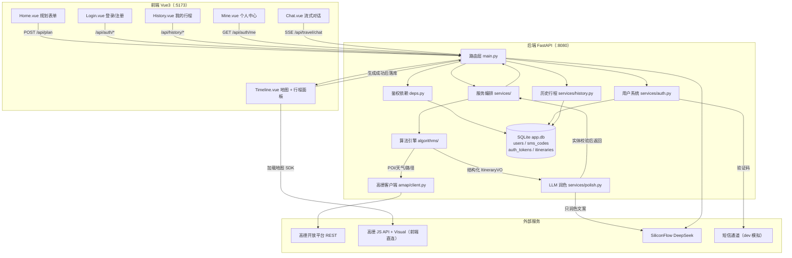
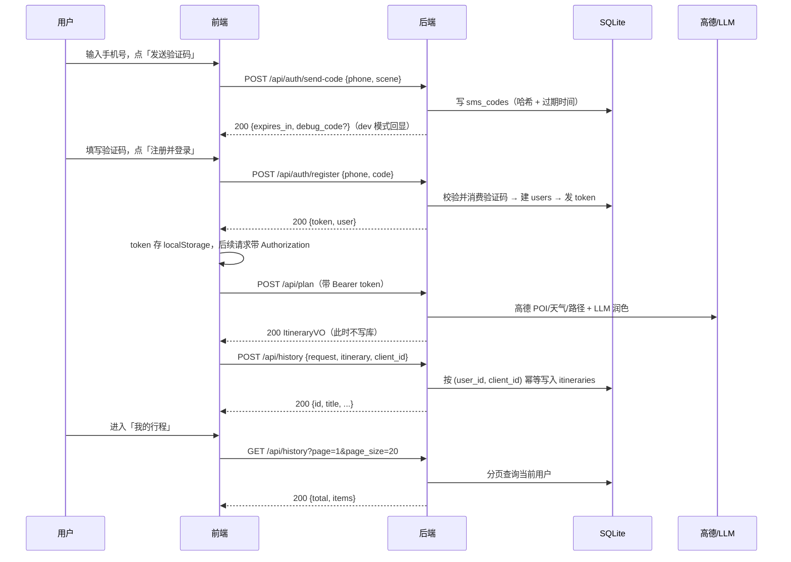
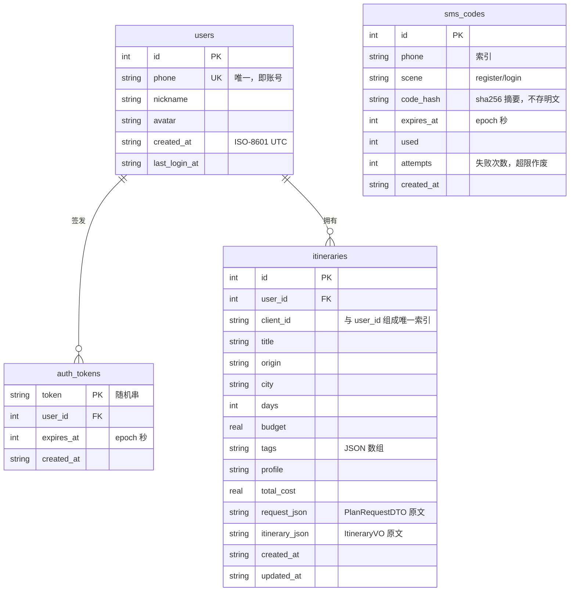
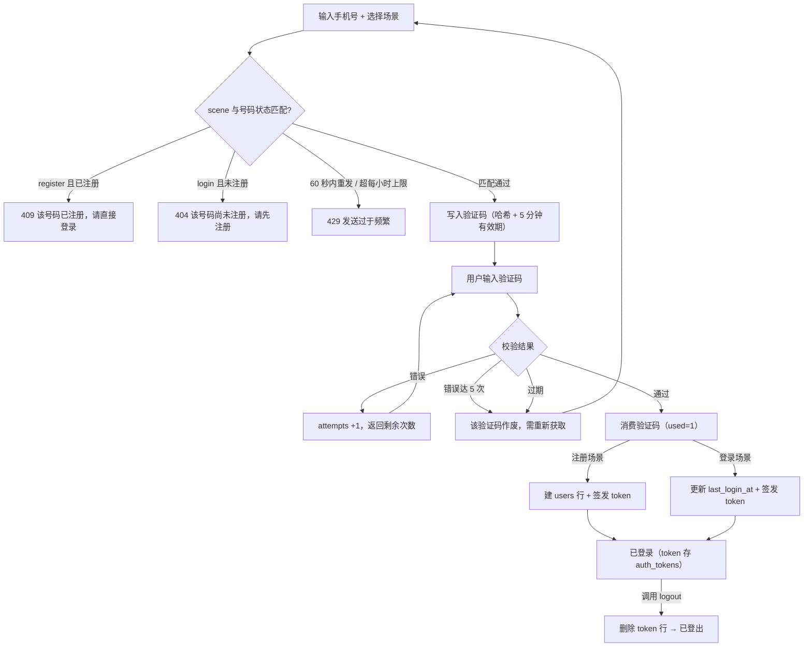
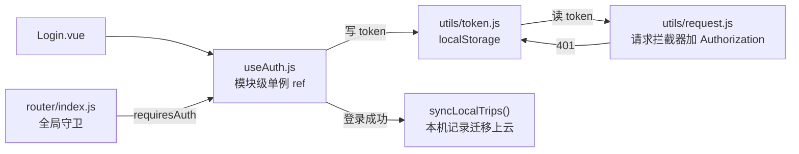

# AI 旅游助手（AI Travel Assistant）

> 算法驱动的智能行程规划系统：用自然语言或表单给出城市、天数、兴趣与同行人，自动完成 **POI 选点 → 空间聚类 → 时间容量选点 → 路径优化 → 时间排程**，再由大模型润色文案。上层是一个能自主调用 **14 个工具**的 Agent（含 **RAG 知识库**检索与用户长期偏好），最终在移动端以「全屏高德地图 + 可拖拽行程面板」的形式呈现。支持 **账号密码注册/登录**，账号信息与用户生成的历史行程持久化到数据库。
>
> **一条边界贯穿始终**：Agent 只做编排，**景点 / 顺序 / 时间只能由算法引擎产出**。14 个工具里唯一能返回 `ItineraryVO` 的是 `plan_itinerary`，其余都是事实查询或算法子步骤。

- 后端：Python · FastAPI（自研算法引擎，不依赖 OR-Tools / numpy 等重型依赖）
- 前端：Vue 3 · Vant 4（移动端）· Element Plus 2（桌面端）· 高德地图 JS API 2.0
- 数据库：SQLite（标准库 `sqlite3`，零 ORM；FTS5 全文本 + 向量 BLOB 双索引）
- 外部服务：高德开放平台（POI / 天气 / 地理编码 / 路径规划 / 数据可视化）、DeepSeek 大模型（官方 API，兼容 SiliconFlow 等 OpenAI 兼容端点；对话 / 工具调用 / 图像理解 / Embedding 共用一套 Key）

---

## 目录

- [一、核心特性](#一核心特性)
- [二、技术栈](#二技术栈)
- [三、项目结构](#三项目结构)
- [四、系统架构](#四系统架构)
- [五、快速开始](#五快速开始)
- [六、环境变量配置](#六环境变量配置)
- [七、高德开放平台配置（重点）](#七高德开放平台配置重点)
- [八、API 接口文档](#八api-接口文档)
- [九、数据契约 ItineraryVO](#九数据契约-itineraryvo)
- [十、前端页面说明](#十前端页面说明)
- [十一、算法引擎详解](#十一算法引擎详解)
- [十二、缓存与降级机制](#十二缓存与降级机制)
- [十三、开发约定与注意事项](#十三开发约定与注意事项)
- [十四、常见问题 FAQ](#十四常见问题-faq)
- [十五、版本与历史](#十五版本与历史)
- [十六、用户系统与数据库设计](#十六用户系统与数据库设计)

---

## 一、核心特性

### 规划能力
- **结构化参数输入**：目的地、天数（1–30）、兴趣标签（历史/自然/美食/购物/艺术/夜生活）、必去景点、规避景点、出行风格（悠闲/经典/尽览）、行程节奏（紧凑/适中/宽松）、同行伙伴（独自/家庭/情侣/朋友/老人）。
- **真实地图数据**：接入高德 POI 文本搜索、天气、地理编码、公交路径规划，景点坐标、评分、类型均来自真实数据而非大模型编造。
- **自研算法全链路**：KMeans++ 空间分天 → 三维评分（兴趣/口碑/绕路）+ 时间容量选点 → 贪心最近邻 + 2-opt 路径优化 → 营业时间/用餐时段/交通耗时时间排程。
- **可解释评分**：每个景点给出 `兴趣匹配 / 高德口碑 / 绕路成本` 三维归一化分数（0–1），前端可直接展示。
- **天气硬约束**：雨天自动剔除室外景点（必去景点除外）。
- **多偏好方案**：三套出行风格（悠闲 / 经典 / 尽览）**同时改变评分权重与每日时间预算**，选点结果不同而非文案不同。
- **LLM 只做表达**：大模型仅根据算法产出的结构化 JSON 生成行程描述与每日导语，**无权修改任何时间、地点**；润色结果再经实体校验，防止模型"幻觉"出不存在的景点。

### Agent 与 RAG
- **Function Calling 主循环**：14 个工具（地理编码 / POI 搜索 / 天气 / 知识库检索 / 行程生成 / 路线优化 / 排程 / 预算校验 / 城际估算 / 历史回看 / 偏好读取…），模型自主决定调哪些、调几次、何时停。
- **工具按需挂载**：首轮只给 6 个核心工具，出现「调整 / 换顺序 / 太满 / 超预算 / 为什么」等信号时才追加其余 8 个 —— schema 每轮都要带，这一步省下约 40% 输入 token。
- **降级即兜底**：轮数 / 工具数 / 时长任一耗尽，平滑切到确定性链路（等价于原来的 `/api/parse → /api/plan`）。**最差体验等于没有 Agent 之前**。
- **RAG 混合检索**：自研中文字符分词（bigram + unigram）+ FTS5 倒排 + 向量双索引；BM25 ∥ 向量 → RRF 融合 → LLM 重排。Embedding 不可用时整体退化为纯关键词检索，不报错。
- **四道防线防幻觉**：工具夹持（行程只能来自 `plan_itinerary`）、实体校验（文案里出现行程外景点名则删句）、引用校验（答复引用的 chunk 必须来自本次检索）、反查校验（地点必过高德逐个核对）。
- **可观测**：会话过程中推送 10 类 SSE 事件（思考 / 工具开始 / 工具结束 / 检索命中 / 行程 / 画像更新…），前端渲染成「思考链 + 工具卡片」。

### 交互体验
- **首页**：**「一句话规划」自然语言输入**（AI 解析后回填表单并展示"已识别/默认值/提示"回执）、出发地 + 目的地双输入、热门目的地轮播、天数/偏好弹层、蓝紫渐变「AI 规划旅程」按钮、历史线路本地存档、线路导入入口。
- **行程页**：上半屏为**嵌入高德 SDK 的全屏可视化地图**（带数据可视化项目图层、景点序号 Marker、按天着色路线），下半屏为**可上下拖拽的 Bottom Sheet 面板**（三档吸附：全屏 / 半屏 / 收拢），面板内含行程总览、单日详情、待安排、旅行灵感、预订管理等视图。
- **AI 对话**：Agent 页基于 SSE 事件流，实时展示**思考链 + 工具卡片 + 检索来源**，最终答复逐字输出；空状态给可点示例直接发起。
- **移动端优先**：Vant 4 组件库，圆角卡片 + 蓝紫主色，对标主流旅行 App 视觉。

### 工程能力
- 高德 POI / 交通结果 **24 小时 / 7 天本地文件缓存**，按需调用，节省配额。
- 高德不可用或 Key 未配置时自动**降级**（`enhanced=false`），服务不直接报错。
- 前端 Vite 代理 `/api → 8080`，开发环境无跨域困扰。
- 旧版纯 LLM 推荐接口（`POST /api/travel/recommend`）**已下线**，代码保留作架构演进对照（见「附录 · 已下线接口」）。

### 用户系统与数据持久化
- **账号密码注册 / 登录**：`pbkdf2-sha256` + 每用户独立 salt（16 字节）+ 20 万次迭代，存储格式 `pbkdf2$迭代$salt$hash`，换算法时可平滑迁移；账号 3–20 位（字母/数字/下划线/中文），归一为小写存储，避免 `Alice` 与 `alice` 撞车。
- **存库的不透明 Token**：登录态用随机串存 `auth_tokens` 表，服务端可主动作废（退出登录即删行），无需 JWT 依赖。
- **行程历史持久化**：用户登录后生成的行程（完整 `ItineraryVO`）保存到账号下，支持分页列表、回看、删除、以及本机记录批量导入（按 `client_id` 幂等去重）。
- **未登录也能用**：规划与 Agent 对话都不要求登录（`current_user_optional`）；未登录时历史线路存在浏览器 `localStorage`，登录后自动迁移上云。

---

## 二、技术栈

### 后端（`backed/`）

| 分类 | 技术 | 版本 | 用途 |
| --- | --- | --- | --- |
| 语言 | Python | 3.10+ | 推荐 3.11 / 3.12 |
| Web 框架 | FastAPI | 0.115.0 | HTTP API、参数校验、SSE |
| ASGI 服务 | uvicorn[standard] | 0.30.6 | 应用服务器（热重载） |
| 数据校验 | Pydantic | 2.9.2 | DTO / VO 模型 |
| HTTP 客户端 | httpx | 0.27.2 | 调用高德、大模型（支持流式） |
| 配置 | python-dotenv | 1.0.1 | 读取 `.env` |
| 数据库 | SQLite + 标准库 `sqlite3` | — | 用户、验证码、登录态、历史行程，**无 ORM** |
| 算法 | 纯 Python 标准库 | — | KMeans / 背包 / 2-opt，**无 numpy / OR-Tools** |

### 前端（`fronted/travel/`，双端同工程）

**同一个 Vite 工程、两个入口**，共用后端、算法、`src/api`、`src/utils`、`src/composables`：

| 入口 | 访问路径 | UI 组件库 | 定位 |
| --- | --- | --- | --- |
| 移动端 H5 | `/` | Vant 4 | 手机浏览器 / 微信内打开 |
| 桌面端 Web | `/pc/` | Element Plus 2 | 电脑浏览器，行程与地图左右并排 |

| 分类 | 技术 | 版本 |
| --- | --- | --- |
| 框架 | Vue | ^3.5.40（Composition API + `<script setup>`） |
| 构建工具 | Vite | ^8.1.5（多入口构建） |
| UI 组件（移动端） | Vant | ^4.10.2 |
| UI 组件（桌面端） | Element Plus | ^2.14.7（+ `@element-plus/icons-vue`） |
| 路由 | Vue Router | ^4.3.0（移动端 history / 桌面端 hash） |
| HTTP | axios | ^1.20.0 |
| 地图 | 高德 JS API | 2.0（含 `AMap.Visual` 插件） |
| Node 运行时 | Node.js | ^22.18 或 ≥24.12 |

### 外部服务

| 服务 | 用途 | 配置位置 |
| --- | --- | --- |
| 高德开放平台 · Web 服务 Key | 后端 REST：地理编码 / 天气 / POI / 公交 | `backed/.env` 的 `AMAP_KEY` |
| 高德开放平台 · Web 端 JS Key + 安全密钥 | 前端地图渲染 | `fronted/travel/.env.local` 的 `VITE_AMAP_KEY` / `VITE_AMAP_SECURITY_CODE` |
| 高德数据可视化 · Visual 项目 ID | 前端地图可视化图层 | 同上 `VITE_AMAP_VISUAL_ID` |
| SiliconFlow / DeepSeek 大模型 | 行程润色 + 流式对话 | `backed/.env` 的 `LLM_*`（Key 与 `LLM_BASE_URL` 必须同源） |
| 短信通道 | 注册/登录验证码 | `backed/.env` 的 `SMS_*`（当前 `dev` 模拟模式） |

---

## 三、项目结构

```
AI-travel-assistant/
├── back/                            # 【历史版本】早期 Spring Boot(Java) 实现，已被 backed 替代
│   └── ai-travel-assistant/
│       └── pom.xml                  # Java 17 + Spring Boot 4.1.1（仅存档，不参与运行）
│
├── docs/                            # ================= 参赛技术文档（可重新生成）=================
│   ├── AI旅游助手-技术文档.docx      # 交付物：Word 源文件（可编辑）
│   ├── AI旅游助手-技术文档.pdf       # 交付物：PDF（27 页，未超 30 页上限）
│   ├── make_figures.py              # 生成 6 张示意图（Pillow 手绘，无需 matplotlib）
│   ├── build_doc.py                 # 正文内容与 DOCX 生成（python-docx）
│   ├── build_all.py                 # 两遍法：算目录页码 → 回填 → 导出 PDF
│   └── figures/                     # 示意图 PNG
│
├── backed/                          # ================= 当前后端（FastAPI）=================
│   ├── .env                         # 环境变量（含密钥，勿提交）
│   ├── .env.example                 # 环境变量模板
│   ├── requirements.txt             # Python 依赖
│   ├── run.py                       # 启动入口：python run.py（0.0.0.0:8080，热重载）
│   ├── data/                        # 静态数据表 + SQLite 数据库
│   │   ├── cities.json              # 城市配置（adcode、中心坐标、搜索关键词）
│   │   ├── typecode_map.json        # 高德 typecode → 兴趣标签/室内外 属性映射
│   │   └── app.db                   # SQLite 数据库（首次启动自动创建，勿提交）
│   ├── cache/                       # 运行期文件缓存（按城市分目录，自动生成）
│   ├── tests/                       # 测试脚本（无需 pytest）
│   │   ├── test_algorithms.py       # 算法引擎 + 数据管线单测：评分/预算/路径/必去/营业时间/地理编码核对、灵感分类/请求合并/必去匹配/预算利用/导入抽取（离线，140 项）
│   │   ├── test_nl_parse.py         # 自然语言解析单测：规则兜底/白名单/夹取（离线，49 项）
│   │   ├── test_auth_history.py     # 用户系统 + 历史行程集成测试（进程内，54 项）
│   │   └── test_live_http.py        # 针对运行中服务的真实 HTTP 冒烟（含真实 /api/plan）
│   └── app/
│       ├── main.py                  # FastAPI 入口：生命周期建库、CORS、异常处理、全部路由
│       ├── config.py                # 配置读取（LLM、高德、缓存 TTL、数据库、登录态、短信、端口）
│       ├── schemas.py               # Pydantic 模型：PlanRequestDTO / ItineraryVO / 认证与历史 DTO
│       ├── security.py              # 账号校验、pbkdf2 密码哈希、token 生成、脱敏
│       ├── sms.py                   # 短信通道抽象（dev / aliyun / tencent）
│       ├── errors.py                # ApiError 业务异常（统一响应体）
│       ├── deps.py                  # 鉴权依赖：解析 Bearer token → 当前用户
│       ├── llm.py                   # 大模型调用（非流式 chat + 流式 chat_stream）
│       │
│       ├── db/                      # -------- 数据访问层（标准库 sqlite3）--------
│       │   └── database.py          # 连接管理、建表 DDL、事务、时间工具
│       │
│       ├── algorithms/              # -------- 算法引擎（纯 Python，独立可测）--------
│       │   ├── engine.py            # 主编排：串联数据层→筛选→聚类→选点→优化→排程
│       │   ├── models.py            # POI 数据模型、profile 权重表、三维评分函数
│       │   ├── data_loader.py       # 加载 typecode_map / cities，富化原始 POI
│       │   ├── candidate_selector.py# tag 匹配 + 必去硬加 + avoid 过滤
│       │   ├── cluster.py           # 自实现 KMeans（Lloyd + KMeans++ 初始化）
│       │   ├── selector.py          # 时间容量选点（评分降序 + 必去硬约束）
│       │   ├── route_optimizer.py   # 贪心最近邻初始解 + 2-opt 路径优化
│       │   └── scheduler.py         # 时间排程（营业时间/用餐时段/交通耗时）
│       │
│       ├── amap/                    # -------- 高德数据层 --------
│       │   ├── client.py            # REST 客户端：geocode/weather/POI/transit
│       │   └── cache.py             # 文件缓存（带 TTL）
│       │
│       ├── rag/                     # -------- 检索层（RAG）--------
│       │   ├── tokenize.py          # 中文 bigram + unigram 分词（无 jieba 依赖）
│       │   ├── pipeline.py          # 元数据头解析 → 清洗 → 标题感知切分 → content_hash
│       │   ├── embedding.py         # Embedding 客户端（磁盘缓存 / 维度守卫 / 熔断）
│       │   ├── indexer.py           # FTS5 + 向量双写；写入后断言两表行数一致
│       │   ├── retriever.py         # BM25 ∥ 向量 → RRF(k=60) → LLM 重排
│       │   └── bootstrap.py         # 启动增量索引 + POI 索引调度
│       │
│       ├── agent/                   # -------- Agent 运行时 --------
│       │   ├── orchestrator.py      # Function Calling 主循环 + RunBudget + 重复调用检测
│       │   ├── registry.py          # 工具注册表（签名反射 Schema + 四道执行守卫）
│       │   ├── tools/               # 14 个工具（geo/search/weather/plan/decide/knowledge/…）
│       │   ├── protocol.py          # 系统提示词 + F1/F2/F3 输出验签
│       │   ├── fallback.py          # 确定性兜底（等价于原 /api/plan 链路）
│       │   ├── memory.py            # 短期会话压缩 + 长期偏好画像
│       │   ├── context.py           # 上下文装配与裁剪
│       │   ├── events.py            # 10 类 SSE 事件
│       │   └── results.py           # ToolResult 泛型
│       │
│       └── services/                # -------- 业务编排 --------
│           ├── plan.py              # /api/plan：engine.solve() → polish_itinerary()
│           ├── polish.py            # LLM 文案润色 + JSON 抽取 + 实体校验
│           ├── travel.py            # 【已下线】旧版纯 LLM 推荐（保留作演进对照，无路由）
│           ├── auth.py              # /api/auth/*：账号密码注册、登录、鉴权、退出
│           ├── history.py           # /api/history/*：落库、分页、详情、删除、批量导入
│           ├── nl_parse.py          # /api/parse：自然语言 → 结构化参数（LLM 只抽取）
│           ├── importer.py          # /api/import/*：文字/图片里的地点 → 高德逐个校验
│           ├── vision.py            # /api/vision/recognize：图片 → 结构化地点
│           ├── inspiration.py       # /api/inspiration：旅行灵感流（真实地点卡片，不调 LLM）
│           ├── intercity.py         # /api/intercity：城际距离 + 驾车耗时估算（不伪造班次）
│           ├── mapimage.py          # /api/map/thumbnail：高德静态地图代理 + 进程内缓存
│           ├── poi_prices.py        # 语料票价抽取 + 从严匹配（五档 kind）
│           ├── poi_pool.py          # 用知识库景点名反查高德，扩充候选池
│           ├── city_registry.py     # 城市清单单一来源（经 /api/meta 下发）
│           ├── kb.py                # /api/kb/*：知识库上传 / 重建 / 统计 / 检索
│           ├── agent_chat.py        # /api/agent/chat：SSE 事件流
│           ├── agent_session.py     # 会话与工具调用审计落库
│           └── llm_json.py          # 从 LLM 回复里稳健抽取 JSON（polish / nl_parse 共用）
│
├── knowledge/                       # -------- RAG 语料（人工撰写，按城市/通用/规则分层）--------
│   ├── rules/                       # 系统能做什么、标签定义、preference 权重含义、费用口径
│   ├── general/                     # 跨城串联、预算构成、预约与购票通用规则
│   └── cities/<城市>/               # 每城市 6 篇：概况/交通/片区/餐饮/预约/带老人
│
├── data/                            # 静态数据表 + SQLite
├── scripts/                         # 语料导入、POI 索引重建、票价覆盖率审计
└── tests/                           # 13 套脚本（无需 pytest）
│
└── fronted/
    └── travel/                      # ================= 前端（Vue3 + Vant4）=================
        ├── package.json
        ├── vite.config.js           # 别名 @ → src；多入口（index.html + pc/index.html）；/api 代理 → 8080
        ├── index.html               # 移动端入口 → /src/main.js
        ├── pc/
        │   └── index.html           # 桌面端入口 → /src/pc/main.js
        └── src/
            ├── main.js              # 【移动端】createApp + Vant 全量注册 + router
            ├── App.vue              # 【移动端】router-view + 底部 van-tabbar（登录页自动隐藏）
            ├── router/index.js      # 【移动端】history 路由 + 登录守卫
            │
            ├── api/                 # ===== 双端共用 =====
            │   ├── travel.js        # getMeta / getPlan / parsePlan / importText / getInspiration …
            │   ├── auth.js          # register / login / getMe / logout
            │   ├── agent.js         # Agent 会话（fetch + ReadableStream 手写 SSE 解析）
            │   └── history.js       # 历史行程列表 / 详情 / 保存 / 删除 / 批量导入
            ├── utils/               # ===== 双端共用 =====
            │   ├── request.js       # axios 实例（自动带 Authorization、统一错误包装、401 清理）
            │   ├── token.js         # 登录凭证本地存储（打断循环依赖）
            │   └── localTrips.js    # 本机历史线路（localStorage，可迁移上云）
            ├── composables/         # ===== 双端共用 =====
            │   ├── useAmap.js       # 高德 JS API 动态加载器（从 Vite 环境变量读 Key/安全密钥/Visual）
            │   └── useAuth.js       # 登录态单例（未引入 Pinia，模块级 ref 充当 store）
            ├── components/          # ===== 双端共用组件 =====
            │   └── InspirationCards.vue  # 旅行灵感卡片流（等待页与灵感 Tab 共用）
            │
            ├── views/               # ===== 移动端页面（Vant）=====
            │   ├── Home.vue         # 首页（一句话规划 + 表单 + 历史线路）
            │   ├── Timeline.vue     # 行程页（全屏地图 + 可拖拽 Bottom Sheet）
            │   ├── Chat.vue         # SSE 流式 AI 对话
            │   ├── Login.vue        # 账号密码登录/注册
            │   ├── History.vue      # 我的行程（分页、回看、左滑删除）
            │   ├── Mine.vue         # 个人中心
            │   └── Timeline.vue     # 行程页（地图 + Bottom Sheet + 行程/灵感双 Tab）
            │
            └── pc/                  # ===== 桌面端（Element Plus）=====
                ├── main.js          # createApp + Element Plus + hash router
                ├── App.vue          # 顶部导航 + 用户区 + el-container 外壳
                ├── styles.css       # 桌面端全局样式（主色与移动端一致）
                ├── router/index.js  # hash 路由（base /pc/）+ 登录守卫
                └── views/
                    ├── Home.vue     # 左规划表单 + 右历史行程/热门目的地
                    ├── Timeline.vue # 左行程面板 + 右全幅高德地图（桌面端核心布局）
                    ├── Chat.vue     # SSE 流式对话 + 常用问题侧栏
                    ├── History.vue  # el-table 分页表格 + 查看/删除
                    ├── Login.vue    # 居中登录卡片
                    └── Mine.vue     # 账号信息 + 行程统计 + 系统状态
```

---

## 四、系统架构

系统严格遵循四层分工：**算法引擎独立决策、后端负责编排与鉴权、LLM 仅负责表达、前端负责展示与交互**，数据落 SQLite。



### 一次 `/api/plan` 请求的完整流水线

```mermaid
flowchart LR
    A[PlanRequestDTO] --> B[地理编码 geocode]
    B --> C[查询天气]
    C --> D[拉取多关键词 POI<br/>24h缓存+去重]
    D --> E[typecode 富化<br/>补 tags/室内外/费用]
    E --> F[候选筛选<br/>tag匹配/必去/avoid]
    F --> G[KMeans++ 聚类<br/>POI 分到各天]
    G --> H[雨天过滤室外点]
    H --> I[四维加权评分]
    I --> J[时间容量选点<br/>评分降序 + 必去硬约束]
    J --> K[贪心+2-opt<br/>路径优化]
    K --> L[按路径顺序重算评分]
    L --> M[时间排程<br/>营业/用餐/交通]
    M --> N{总费用超预算?}
    N -->|是| O[删最低分点重算]
    N -->|否| P[组装 ItineraryVO]
    O --> P
    P --> Q[LLM 润色 description/导语]
    Q --> R[实体校验防幻觉]
    R --> S[返回 JSON]
```



**架构边界（关键设计原则）**

1. 景点、顺序、时间、费用**只能由算法决定**；
2. LLM 接收的是结构化行程 JSON，产出也只能是描述性文案；
3. LLM 输出经 `_validate_entities()` 校验，出现行程之外的景点名即丢弃对应句子；
4. 前端只做渲染与交互，不做任何规划决策；
5. 用户系统与历史行程属于**旁路能力**：`/api/plan` 保持无状态，落库由前端拿到结果后显式调用 `POST /api/history`，历史模块只搬运算法产出的原文、不做二次加工。

### 一次登录 + 规划 + 落库的调用顺序



---

## 五、快速开始

### 环境要求

- Python 3.10+（推荐 3.11/3.12）
- Node.js 22.18+ 或 24.12+（`package.json#engines` 要求）
- npm
- 可用的高德开放平台 Key、SiliconFlow API Key

### 1. 启动后端（端口 8080）

```bash
# 进入后端目录
cd backed

# 创建并激活虚拟环境（Windows PowerShell）
python -m venv .venv
.\.venv\Scripts\Activate.ps1
#   Windows CMD 写法： .venv\Scripts\activate.bat
#   macOS/Linux 写法： source .venv/bin/activate

# 安装依赖
pip install -r requirements.txt

# 复制并编辑环境变量（填入高德 Web 服务 Key 与 LLM Key）
copy .env.example .env        # Windows
# cp .env.example .env        # macOS/Linux

# 启动（热重载，监听 0.0.0.0:8080）
python run.py
```

启动成功后可访问：

- 接口文档（Swagger UI）：<http://localhost:8080/docs>
- 调试接口（浏览器直接打开即可看完整 JSON）：
  <http://localhost:8080/api/debug/plan?city=杭州&days=3&budget=2000&tags=历史,自然,美食&profile=舒适型>

> **数据库无需手动初始化**：首次启动时 `lifespan` 会自动在 `backed/data/app.db` 建库建表（幂等）。
> 想重置数据直接删掉该文件（含 `-wal` / `-shm`）重启即可。
>
> **注册登录无需真实短信**：默认 `SMS_PROVIDER=dev`，验证码会打印在后端日志里，
> 同时回显在 `/api/auth/send-code` 响应的 `data.debug_code` 字段，前端会自动填入输入框。

### 1.1 跑测试（可选）

所有测试脚本都**不需要 pytest**，直接 `python` 运行：

```bash
cd backed

# 算法引擎 + 数据管线单测：绕路基点/预算/精确路径/必去硬约束/营业时间解析/灵感分类/请求合并/必去匹配/预算利用/导入抽取（离线，140 项）
python tests/test_algorithms.py

# 自然语言解析单测：规则兜底/白名单/范围夹取/JSON 抽取（离线，49 项）
python tests/test_nl_parse.py

# 用户系统 + 历史行程集成测试（进程内执行，不消耗高德/LLM 配额，54 项）
python tests/test_auth_history.py

# 针对运行中服务的真实 HTTP 冒烟（会真实调用 /api/plan，消耗配额，20 项）
python tests/test_live_http.py
```

> `test_live_http.py` 会撞到短信 60 秒发送间隔，脚本已内置按提示等待重试，
> 可以连续反复运行。

### 1.2 重新生成参赛技术文档（可选）

`docs/` 下的技术文档由脚本生成，改了代码或数据后可以一键重出：

```bash
# 1) 重新生成 6 张示意图（改了实测数据时才有必要）
python docs/make_figures.py

# 2) 生成 DOCX 并转 PDF（自动用两遍法算目录页码）
python docs/build_all.py
```

> 目录页码为什么要两遍：LibreOffice 转换时**不会**填充 Word 的 TOC 域，
> 所以脚本先按「封面 + 目录 + 前 k 章」逐级构建并取页数，得到每章起始页后再回填目录。
> `build_all.py` 会同时报告总页数，超过大赛 30 页上限时会给出警告。

### 2. 启动前端（端口 5173）

```bash
# 新开一个终端
cd fronted/travel

# 安装依赖
npm install
# 国内网络拉 npmjs 超时/被重置时改用镜像：
# npm install --registry https://registry.npmmirror.com

# 启动开发服务器
npm run dev
```

打开下面任一地址即可使用（**同一个 dev server，两个入口**）：

| 终端 | 地址 | 说明 |
| --- | --- | --- |
| 移动端 H5 | <http://localhost:5173/> | Vant 4，手机浏览器 / DevTools 移动视图 |
| 桌面端 Web | <http://localhost:5173/pc/> | Element Plus，电脑浏览器，行程与地图左右并排 |

前端通过 Vite 代理把 `/api` 请求转发到 `http://localhost:8080`（见 `vite.config.js`），无需关心跨域。

> 前端地图 Key 配置见下一节，**不配置地图 Key 不影响行程生成**，只是行程页地图无法渲染。

### 3. 生产构建（可选）

```bash
cd fronted/travel
npm run build      # 一次构建产出两个入口
npm run preview    # 本地预览构建产物
```

产物结构（`dist/` 直接丢到任意静态服务器即可，两个入口共用一份 `assets/`）：

```
dist/
├── index.html          # 移动端，部署在站点根路径 /
├── pc/
│   └── index.html      # 桌面端，部署在 /pc/
└── assets/             # 两端共用（各自独立的 js/css，互不干扰）
```

> **桌面端为什么用 hash 路由**：两端同工程同 `dist`，若桌面端也用 history 模式，
> 刷新 `/pc/timeline` 会被静态服务器回退到移动端的 `index.html`。
> hash 模式（`/pc/#/timeline`）不需要任何服务端 rewrite 规则，
> 开发、预览、静态托管（含 GitHub Pages）都能直接用。

---

## 六、环境变量配置

后端配置文件为 `backed/.env`（从 `.env.example` 复制）。所有变量均可被系统环境变量覆盖。

| 变量名 | 说明 | 默认值 |
| --- | --- | --- |
| `LLM_API_KEY` | 大模型 API 密钥 | 空（**不硬编码默认值**，必须由 `.env` 提供） |
| `LLM_BASE_URL` | 大模型服务地址（任何 OpenAI 兼容端点均可） | `https://api.siliconflow.cn` |
| `LLM_MODEL` | 模型名 | `deepseek-ai/DeepSeek-V4-Pro` |
| `AMAP_KEY` | 高德 **Web 服务** Key（后端 REST 调用用） | 空（为空时走降级模式） |
| `AMAP_BASE` | 高德 REST 基地址 | `https://restapi.amap.com/v3` |
| `POI_CACHE_TTL` | POI 缓存有效期（秒） | `86400`（24 小时） |
| `MATRIX_CACHE_TTL` | 交通矩阵缓存有效期（秒） | `604800`（7 天） |
| `PORT` | 后端服务端口 | `8080` |
| `DB_PATH` | SQLite 数据库文件路径（相对路径按 `backed/` 解析，留空用默认） | `data/app.db` |
| `TOKEN_TTL_DAYS` | 登录 token 有效期（天） | `30` |
| `SMS_PROVIDER` | 短信通道：`dev` / `aliyun` / `tencent` | `dev` |
| `SMS_CODE_TTL` | 验证码有效期（秒） | `300` |
| `SMS_SEND_INTERVAL` | 同一手机号两次发送的最小间隔（秒） | `60` |
| `SMS_HOURLY_LIMIT` | 同一手机号每小时最多发送次数 | `10` |
| `SMS_MAX_ATTEMPTS` | 单个验证码最多允许校验失败次数 | `5` |
| `SMS_DEBUG_ECHO` | dev 模式下是否把验证码回显到接口响应（**生产必须 false**） | `true` |

> 表中"默认值"是**代码在完全没有 `.env` 时的兜底值**（见 `app/config.py`）。实际运行时以 `.env` 为准。

#### ⚠️ `LLM_API_KEY` 必须与 `LLM_BASE_URL` 同源

Key 和接口地址不属于同一家平台时，调用会返回 `401 {"code":30014,"message":"Token is invalid."}`。
两家的 Key 格式可以直接区分：

| 平台 | Key 格式 | `LLM_BASE_URL` | `LLM_MODEL` |
| --- | --- | --- | --- |
| DeepSeek 官方（platform.deepseek.com） | `sk-` + 32 位十六进制（共 35 字符） | `https://api.deepseek.com` | `deepseek-chat` |
| 硅基流动 SiliconFlow | `sk-` + 48 位字母数字（共 51 字符） | `https://api.siliconflow.cn` | `deepseek-ai/DeepSeek-V4-Pro` |

只要服务是 OpenAI 兼容的 `/v1/chat/completions`，换任何一家都可以。项目当前使用并已验证的是 **DeepSeek 官方**这一组。

`.env` 示例：

```env
# DeepSeek 官方平台（当前项目使用并已验证的配置）
LLM_API_KEY=sk-你的DeepSeek密钥
LLM_BASE_URL=https://api.deepseek.com
LLM_MODEL=deepseek-chat

# 若改用硅基流动，换成下面三行（Key 与地址必须同源）
# LLM_API_KEY=sk-你的硅基流动密钥
# LLM_BASE_URL=https://api.siliconflow.cn
# LLM_MODEL=deepseek-ai/DeepSeek-V4-Pro

AMAP_KEY=你的高德Web服务Key

# 数据库（留空即 backed/data/app.db），首次启动自动建表
DB_PATH=

# 登录态有效期
TOKEN_TTL_DAYS=30

# 短信：dev = 不真发短信，验证码写日志并回显（本地开发/答辩演示用）
SMS_PROVIDER=dev
SMS_DEBUG_ECHO=true
```

> **安全提示**：密钥一律通过**不入库的环境变量文件**配置——后端用 `backed/.env`，前端用 `fronted/travel/.env.local`（两者均已被 `.gitignore` 忽略）。源码中不存在任何硬编码密钥，可安全公开仓库。`.gitignore` 同时忽略 `.venv/`、`*.db`、`backed/cache/`。仍建议在高德 / SiliconFlow 控制台配置配额与用量告警。
>
> **上线前必须做两件事**：把 `SMS_PROVIDER` 换成真实通道，并把 `SMS_DEBUG_ECHO` 设为 `false`，否则验证码会随响应返回给任意调用者。

---

## 七、高德开放平台配置（重点）

本项目同时使用了高德的**两套 Key**，容易混淆，请按下表分别申请：

| Key 类型 | 使用方 | 申请位置 | 配置位置 |
| --- | --- | --- | --- |
| **Web 服务** Key | 后端服务器（REST） | 控制台 → 应用管理 → 添加 Key → 服务平台选「Web服务」 | `backed/.env` 的 `AMAP_KEY` |
| **Web 端 (JS API)** Key + 安全密钥 `securityJsCode` | 浏览器前端地图 | 控制台 → 应用管理 → 添加 Key → 服务平台选「Web端(JS API)」 | `fronted/travel/.env.local` 的 `VITE_AMAP_KEY` |

### 1. 后端 Web 服务 Key

在 [高德开放平台控制台](https://console.amap.com/dev/key/app) 创建应用 → 添加 Key → 服务平台选择 **Web 服务**，把生成的 Key 填入 `backed/.env` 的 `AMAP_KEY`。该 Key 用于：

- `geocode/geo`：城市名 → adcode 与中心坐标
- `weather/weatherInfo`：未来 4 天天气
- `place/text`：POI 关键词搜索
- `direction/transit/integrated`：公交路径规划

### 2. 前端 Web 端 JS Key + 安全密钥

**前端密钥不写死在代码里**，而是通过 Vite 环境变量注入（`.env.local` 已被 `.gitignore` 忽略，不会进公开仓库）：

```powershell
cd fronted/travel
Copy-Item .env.example .env.local
# 然后编辑 .env.local，填入下面三项
```

```ini
VITE_AMAP_KEY=你的 Web端(JS API) Key
VITE_AMAP_SECURITY_CODE=你的安全密钥
VITE_AMAP_VISUAL_ID=你的可视化项目ID   # 可选，留空即跳过可视化图层
```

2021 年 12 月之后申请的 JS API Key 必须配套使用安全密钥。`useAmap.js` 会在 JS API 脚本加载**之前**注入：

```js
// src/composables/useAmap.js —— 从环境变量读取，无硬编码
const AMAP_KEY = import.meta.env.VITE_AMAP_KEY || ''
const AMAP_SECURITY_CODE = import.meta.env.VITE_AMAP_SECURITY_CODE || ''

window._AMapSecurityConfig = { securityJsCode: AMAP_SECURITY_CODE }
```

> **只有 `VITE_` 前缀的变量才会被 Vite 暴露给前端**，这是 Vite 的安全设计，用来避免把后端密钥误打进前端产物。

`useAmap.js` 用一个全局 Promise 保证地图脚本只加载一次，多处调用共享同一个 `AMap`。**缺少 `VITE_AMAP_KEY` 时会抛出明确可操作的错误**（提示去建 `.env.local`），而不是让地图静默白屏。

> **前端 Key 一定会被看到**：JS Key 体现在浏览器加载的 `script src` 里，任何访客都能拿到，这是高德 JS API 的固有设计。真正的防护手段是**在控制台配置域名白名单**（本地开发加入 `localhost`）——白名单之外的站点即使拿到 Key 也无法调用，配额不会被盗刷。
>
> 生产环境还可改用「代理服务器转发安全密钥」方案，进一步避免 `securityJsCode` 暴露在前端；本项目为教学/比赛场景采用前端直配方式。

### 3. 数据可视化 Visual 项目 ID

行程页地图加载了高德**数据可视化平台（Visual）**的自定义图层，项目 ID 同样通过环境变量配置：

```ini
# fronted/travel/.env.local
VITE_AMAP_VISUAL_ID=你的可视化项目ID
```

```js
// src/composables/useAmap.js
export const AMAP_VISUAL_ID = import.meta.env.VITE_AMAP_VISUAL_ID || ''
// 初始化（仅在配置了 ID 时执行）：
if (AMAP_VISUAL_ID) new AMap.Visual('amap://visual/' + AMAP_VISUAL_ID, map)
```

**留空是合法配置**：此时跳过可视化图层，基础地图、景点 Marker 与路线照常渲染。

---

## 八、API 接口文档

服务基地址：`http://localhost:8080`
统一响应包装：`{ "success": true, "code": 200, "message": null, "data": ... }`

**全部路由共 31 个**，本节详述核心链路。其余分组见下表，参数以 `backed/app/schemas.py` 为准：

| 分组 | 路由 |
| --- | --- |
| 认证 | `/api/auth/{register, login, me, logout}` |
| 历史 | `/api/history`（列表 / 保存）、`/api/history/import`、`/api/history/{id}`（详情 / 删除） |
| 规划 | `/api/plan`、`/api/parse`、`/api/debug/plan` |
| 导入 | `/api/import/text`、`/api/import/image` |
| 视觉 | `/api/vision/recognize` |
| 旁路 | `/api/inspiration`、`/api/intercity`、`/api/map/thumbnail` |
| 知识库 | `/api/kb/{stats, files, reindex, upload, search}` |
| Agent | `/api/agent/chat`（SSE）、`/api/agent/tools`、`/api/agent/sessions`、`/api/agent/session/{id}`、`/api/agent/profile` |
| 元数据 | `/api/meta`（标签 / 风格 / 天数上下限 / 城市清单，前端唯一来源） |

### 1. POST `/api/plan` —— 算法引擎行程规划（核心）

**请求体 `PlanRequestDTO`**

| 字段 | 类型 | 必填 | 约束 | 说明 |
| --- | --- | --- | --- | --- |
| `city` | string | 是 | — | 目的地城市，如 `杭州` |
| `days` | int | 是 | 1–30 | 旅行天数 |
| `tags` | string[] | 是 | 取值见下 | 兴趣标签 |
| `must_go` | string[] | 否 | — | 必去景点名称（强制加入） |
| `avoid` | string[] | 否 | — | 规避景点名称（过滤） |
| `profile` | string | 否 | — | `经济型` / `舒适型`（默认）/ `紧凑型` |

- `tags` 可选值：`历史`、`自然`、`美食`、`购物`、`艺术`、`夜生活`

**请求示例**

```bash
curl -X POST http://localhost:8080/api/plan \
  -H "Content-Type: application/json" \
  -d '{
    "city": "杭州",
    "days": 3,
    "budget": 2000,
    "tags": ["历史", "自然", "美食"],
    "must_go": [],
    "avoid": [],
    "profile": "舒适型"
  }'
```

**响应**：`data` 为 `ItineraryVO`（结构见[第九节](#九数据契约-itineraryvo)）。

### 2. GET `/api/meta` —— 表单元数据

返回前端渲染表单所需的可选项与高德启用状态：

```json
{
  "success": true,
  "tags": ["历史", "自然", "美食", "购物", "艺术", "夜生活"],
  "profiles": ["经济型", "舒适型", "紧凑型"],
  "amap_enabled": true
}
```

### 3. GET `/api/debug/plan` —— 浏览器调试接口

GET 形式方便直接在浏览器查看完整结果，参数通过 query 传递（`tags` 用逗号分隔）：

```
GET /api/debug/plan?city=杭州&days=3&budget=2000&tags=历史,自然,美食&profile=舒适型
```

返回 `{ success, amap_enabled, request, itinerary }`。

### 3.1 POST `/api/parse` —— 自然语言需求解析

把一句自然语言翻译成结构化规划参数（**不产生行程**）。

**请求体 `ParseRequestDTO`**

| 字段 | 类型 | 必填 | 说明 |
| --- | --- | --- | --- |
| `text` | string | 是 | 用户自然语言描述，1–500 字 |
| `defaults` | PlanRequestDTO | 否 | 兜底值（如表单已填内容）；文本中没提到的字段沿用它 |

```bash
curl -X POST http://localhost:8080/api/parse \
  -H "Content-Type: application/json" \
  -d '{"text":"带爸妈去苏州玩三天，预算2500，喜欢历史和园林，轻松点"}'
```

**响应 `data` 为 `ParsedPlanVO`**：

```jsonc
{
  "request": {                        // 可直接提交给 /api/plan
    "city": "苏州", "days": 3, "budget": 2500.0,
    "tags": ["历史"], "must_go": [], "avoid": [], "profile": "舒适型"
  },
  "inferred": ["目的地", "天数", "预算", "兴趣偏好", "出行节奏"],  // 真正从文本识别的
  "assumed": [],                      // 文本没提到、用了默认值的
  "notes": [],                        // 越界夹取、降级解析等提示
  "source": "llm",                    // llm | rule
  "raw_text": "带爸妈去苏州玩三天…"
}
```

**三道防线保证 LLM 不能乱来**（详见第十六节）：

1. **白名单**：`tags` 只能取 `VALID_TAGS`，`profile` 只能取 `VALID_PROFILES`；
2. **范围夹取**：天数夹到 1–7、预算不低于 100，且把夹取动作回报在 `notes` 里；
3. **规则兜底**：LLM 不可用或返回不可解析时，退回正则 + 城市表的确定性解析
   （`source` 变为 `rule`，并在 `notes` 里说明），弱网/断网也能用。

> 本接口**只做抽取**，不选点、不定顺序、不算时间与费用；
> 真正的规划仍然由 `POST /api/plan` 的算法引擎完成——这是本项目"LLM 只负责表达与翻译、
> 算法负责决策"这条边界的直接体现。

### 5. POST `/api/auth/register` —— 账号密码注册

**请求体 `RegisterDTO`**

| 字段 | 类型 | 必填 | 说明 |
| --- | --- | --- | --- |
| `username` | string | 是 | 3–20 位，字母 / 数字 / 下划线 / 中文；归一为小写存储 |
| `password` | string | 是 | 6–64 位；以 `pbkdf2-sha256` + 独立 salt + 20 万次迭代存哈希 |
| `nickname` | string | 否 | 最长 20 字符，缺省等于 `username` |
| `avatar` | string | 否 | 头像 URL |

**响应 `data` 为 `AuthVO`**：`{ token, expires_in, user: { id, username, nickname, avatar, created_at, last_login_at } }`

注册成功即返回登录态，无需再调登录接口。账号已被占用返回 **409**。

> 注册不需要验证码 —— 账号是自选的、密码只有本人知道，不需要手机号归属验证。
> 旧版 `POST /api/auth/send-code`（短信验证码）**已下线**，调用返回 404。

### 6. POST `/api/auth/login` —— 账号密码登录

**请求体 `LoginDTO`**：`{ username, password }`

- 账号不存在或密码错误统一返回 **401**（不区分，避免账号枚举）；
- 旧手机号账号（`password_hash` 为 NULL）返回明确提示，需重新注册。

### 7. GET `/api/auth/me` —— 当前登录用户

需要 `Authorization: Bearer <token>`，返回 `UserVO`（不含任何密码字段）。无效/过期 token 返回 401。

### 8. POST `/api/auth/logout` —— 退出登录

删除服务端 token（幂等）。未携带凭证返回 401。

### 9. GET `/api/history` —— 历史行程列表

需要登录。Query 参数：`page`（从 1 开始，默认 1）、`page_size`（默认 20，上限 50）。

**响应 `data`**：

```jsonc
{
  "total": 12,
  "page": 1,
  "page_size": 20,
  "items": [
    {
      "id": 7,
      "client_id": "1730000000000",   // 前端本机记录 id，用于幂等
      "title": "当涂出发·杭州2日游",
      "origin": "当涂",
      "city": "杭州",
      "days": 2,
      "budget": 1500,
      "tags": ["历史", "自然"],
      "profile": "舒适型",
      "total_cost": 400.0,
      "spot_count": 10,
      "enhanced": true,
      "created_at": "2026-10-10T12:00:00+00:00"
    }
  ]
}
```

> 列表项**不含完整行程体**，避免列表接口返回巨量 JSON；点进详情再取。

### 10. POST `/api/history` —— 保存历史行程

需要登录。**请求体 `HistorySaveDTO`**：

| 字段 | 类型 | 必填 | 说明 |
| --- | --- | --- | --- |
| `request` | PlanRequestDTO | 是 | 当时的规划入参 |
| `itinerary` | ItineraryVO | 是 | 算法产出的完整行程 |
| `client_id` | string | 否 | 前端本机记录 id，**同一用户下唯一**，重复提交为覆盖更新 |
| `title` / `origin` | string | 否 | 缺省标题按 `{origin}出发·{city}{days}日游` 生成 |
| `created_at` | string | 否 | ISO-8601，缺省用服务端当前时间 |

后端**不对行程做任何二次加工**，只搬运算法原文。

### 11. GET `/api/history/{id}` —— 历史行程详情

需要登录。返回列表项字段 + `request`（原始入参）+ `itinerary`（完整行程）。只能读自己的，他人或无此 id 一律 404。

### 12. DELETE `/api/history/{id}` —— 删除历史行程

需要登录，只能删自己的，否则 404。

### 13. POST `/api/history/import` —— 批量导入本机记录

需要登录。**请求体**：`{ "trips": [ HistorySaveDTO, ... ] }`（单次上限 100 条）

**响应 `data`**：`{ imported, skipped, failed, ids }`

- 逐条校验，**个别数据非法不会导致整批失败**；
- 按 `(user_id, client_id)` 幂等，已存在则计入 `skipped`；
- 前端登录后用它把 `localStorage` 里的旧记录迁移上云。

### 14. POST `/api/travel/chat` —— SSE 流式对话

**请求体**：`{ "message": "杭州三天怎么玩？" }`
**响应**：`Content-Type: text/event-stream`，逐段 `data: {token}` 推送，前端边收边渲染。

### 15. ~~POST `/api/travel/recommend`~~ —— 旧版纯 LLM 推荐（**已下线**）

> **本节保留仅为记录架构演进，该路由已于 M15 下线，调用会返回 404。**

原实现（`app/services/travel.py`）把「每天上午/下午/晚上去哪个景点、门票多少、游览多久、
预算怎么分」**整份交给大模型直接生成**，产出无法被校验——实体校验需要一个基准名单
（算法引擎产出的真实行程），而这里的 LLM 输出本身就是行程，不存在 ground truth。

它与本项目「算法决策、LLM 只负责表达」的核心架构直接冲突，因此下线。
代码保留在 `app/services/travel.py`（文件头有 `.. warning::` 标注），
`TripBaseInfoDTO` / `RecommendVO` 一并留档。需要行程请用 **§1 `POST /api/plan`**。

### 16. GET `/api/intercity` —— 城际交通估算

**参数**：`origin`（出发地，如「当涂」）、`dest`（目的地，如「杭州」）

返回真实地理编码 + 直线距离 + 驾车耗时估算：

```json
{
  "ok": true,
  "origin": { "name": "当涂", "lat": 31.571, "lng": 118.498,
              "resolved_address": "安徽省马鞍山市当涂县" },
  "dest":   { "name": "杭州", "lat": 30.274, "lng": 120.155,
              "resolved_address": "浙江省杭州市" },
  "distance_km": 214.0,
  "drive_minutes": 171,
  "estimated": true,
  "mode": "drive",
  "navigation_url": "https://uri.amap.com/navigation?from=...&to=...",
  "note": "班次数据未接入（铁路/航班需 12306 或 OTA 授权），此处为两地距离与驾车耗时估算"
}
```

> **为什么不返回车次与时刻**：班次数据属于 12306 与 OTA，高德 Web 服务不提供，
> 第三方接入有资质与合规门槛。本项目**不伪造车次号与时刻表**——前端据 `estimated=true`
> 明确显示「估算」，并给出高德导航深链。答辩时这一条是加分项而不是漏洞。
>
> **地理编码核对**：高德 `geocode/geo` 对无法识别的输入会**模糊匹配**并返回某个真实坐标
> （实测请求「不存在的城市xyz」也能拿到坐标）。因此 `geocode()` 会用 `geocode_matches()`
> 核对返回的行政区文本是否真的包含请求地名，不匹配则视为找不到。
> 同时 `resolved_address` 会把高德实际解析到的地址回显到前端——同名异地时
> （实测「乌镇」会解析到陕西、「西湖」会解析到台湾苗栗）用户能一眼看出解析错了。

### 17. GET `/api/map/thumbnail` —— 行程路线缩略图

**参数**：`points`（`lat,lng;lat,lng;...`）、`day_sizes`（`5,5,3`，每天点位数）、`width`、`height`

返回 `image/png`（高德静态地图，**后端代理，Web 服务 Key 不外泄**）；
高德不可用或点位为空时返回 `204 No Content`，前端隐藏缩略图即可。

高德静态地图接口有几个实测坑，已在 `services/mapimage.py` 中记录：
`markers` 尺寸取值是 `small/mid/large`（**不是 medium**）；`paths` 必须给 **5 个字段**；
**多组标注/路径不能用 `|` 拼接**，必须用重复同名参数（`markers=A&markers=B`）；
该接口有 QPS 限制，因此加了进程内缓存（1 小时 TTL）。

### 18. POST `/api/import/text` —— 导入线路/地点

**请求体 `ImportTextDTO`**：`{ text, city? }`

把一段攻略/聊天记录/行程单里的地点导入为可加入行程的必去项：

```json
{
  "city": "苏州",
  "source": "llm",
  "matched_count": 4,
  "unmatched_count": 1,
  "places": [
    { "query": "拙政园", "matched": true,
      "poi": { "name": "拙政园", "lat": 31.3239, "lng": 120.6283,
               "rating": 4.8, "address": "东北街178号", "business_area": "拙政园",
               "photos": ["https://store.is.autonavi.com/..."] } },
    { "query": "星槎幻月太空主题乐园", "matched": false,
      "reason": "高德只找到「太空狗乐园(相城中心)」，与输入不符" }
  ],
  "notes": ["有 1 个地点未能在高德匹配到，已单独列出，不会加入行程"]
}
```

**为什么必须有"未匹配"这一项**

大模型能从文字里认出「老门东、先锋书店、颐和路」这类名字，但它**无法保证这些地方真实存在**。
所以流程是「LLM 抽取地点名 → 逐个走高德 `place/text` 反查 → 匹配到的返回真实 POI」，
匹配不到的**带原因明确列出**。导入功能最常见的坑就是"显示导入成功、实际一半地点没匹配上"——
用户完全看不出来。这与本项目一贯的纪律一致：**界面声称的必须等于系统实际做的**。

其他实现要点：

- 抽取沿用 `/api/parse` 的两道防线：LLM 抽取 + 规则兜底（`source` 会如实标注）；
  大模型不可用时退回分隔符切分，并剥掉"上午去/看夜景。"这类前后缀后逐段反查；
- 反查复用候选筛选的**匹配分档**（完全相等 > 开头匹配 > 包含），
  避免「拙政园」匹配到「片仔癀(拙政园店)」这类同名店铺；
- 地点反查并发 3，与灵感流一致，避免触发高德 QPS 限制；
- 城市优先取请求参数，其次从文字里用**本项目城市表**匹配（不凭空猜城市）；
  没有城市时不做反查（否则结果会跨城漂移），并明确告知。

### 19. GET `/api/inspiration` —— 旅行灵感流

**参数**：`city`（目的地）、`limit`（卡片数上限，默认 120，需足够大以覆盖各分类）

返回目的地的真实地点卡片：

```json
{
  "city": "南京",
  "enhanced": true,
  "total": 24,
  "categories": [{"key": "风景", "count": 26}, {"key": "博物馆", "count": 22},
                 {"key": "美食", "count": 24}, {"key": "其他", "count": 3}],
  "items": [
    { "name": "总统府", "category": "风景", "type": "spot", "rating": 4.7,
      "photos": ["https://store.is.autonavi.com/..."], "business_area": "长江路",
      "address": "长江路292号", "cost": 50.0, "cost_source": "estimated",
      "open_hours": "周二至周日 08:30-18:00", "scenic_level": "国家级景点",
      "tags": ["历史"] }
  ]
}
```

**设计要点**

- **不调用大模型、不做路线计算**，只做「拉 POI + 富化」。目的是能在 `/api/plan`
  需要 20–40 秒的生成空窗期里**立刻返回内容**，把等待时间填住（实测缓存命中约 0.04 s，
  冷启动约 6–7 s，瓶颈在高德接口本身的响应时间）。
- **只输出真实字段**：照片、评分、人均消费（`cost_source` 区分 real/estimated）、
  商圈、营业时间、景区等级，全部来自高德。**刻意不做新闻式标题**——
  高德的 `place/text` 不提供 UGC/编辑文案，本项目也没有内容源，
  硬编「XX 节目单焕新」这类时效性标题就是编造。
- **分类只用真实分类推导**（风景/博物馆/展览/美食/购物/住宿/其他），
  不保留无数据支撑的「新开业」。
- **按类目轮转输出**（`_interleave`），避免高分餐厅把整条流占满。
- 并发拉取关键词（信号量限流 3），规划流程仍走串行，行为不变。
- **同键请求合并**：规划与灵感流会并发拉同一批关键词，`search_pois` 对
  「同一城市 + 同一关键词 + 同一页」的并发请求只发一次、其余等待同一结果
  （用 `asyncio.shield` 保证等待者被取消不会连带取消上游请求）。
  未合并时实测灵感流首屏被拖到 13.1 s，合并后 8.3 s，且**高德请求数不再翻倍**。

**城市取值以行程为准**：从「我的行程」回看时 URL 里只有 `history_id`、没有 `city`，
若回退到硬编码默认城市，就会出现「厦门的行程配杭州的灵感流」。
因此前端用 `effectiveCity`（优先 `itinerary.city`，其次 `query.city`）取城市，
且不再设置默认城市——行程加载后若城市与已加载的灵感流不一致会自动重拉。

前端用它填两个位置：**行程生成中的等待页**，以及行程页的**「旅行灵感」Tab**。
卡片上的「＋ 加进行程」会写入 `must_go` 并重新规划——这条链路在算法里是**硬约束**，
详见第十一章第 5 节。

### 错误响应

所有业务异常（含鉴权、频率限制、资源不存在）HTTP 状态码与响应体统一为：

```json
{ "success": false, "code": 401, "message": "未登录或登录态已失效，请重新登录", "data": null }
```

常见 `code`：`400` 参数/验证码错误、`401` 未登录或 token 失效、`404` 用户未注册或资源不存在、
`409` 手机号已注册、`429` 发送过于频繁、`500` 历史数据损坏、`501` 短信通道未接入、`502` 短信下发失败。

---

## 九、数据契约 ItineraryVO

`/api/plan` 的 `data` 字段结构：

```jsonc
{
  "city": "杭州",
  "profile": "经典",                  // 悠闲 / 经典 / 尽览
  "description": "LLM 润色的顶层描述",
  "enhanced": true,               // true=高德数据增强；false=降级模式
  "weather": ["晴 25°/15°", "..."],   // 每日天气，长度=days
  "days": [
    {
      "date": "Day 1",
      "daily_summary": "LLM 生成的当日导语",
      "items": [
        {
          "type": "spot",         // spot=景点 / restaurant=餐饮 / hotel=住宿
          "name": "杭州博物馆",
          "lat": 30.2456,
          "lng": 120.1550,
          "start": "09:00",
          "end": "11:00",
          "cost": 0.0,            // 仅在 cost_source 有真实来源时非空
          "cost_source": "free",  // real / third_party / free / average / unknown
          "cost_note": "门票免费",
          "open_hours": "周二至周日 09:00-17:00",
          "must_go": false,
          "score": 0.62,          // 综合评分 [0,1]
          "score_breakdown": {
            "interest": 1.0,      // 兴趣匹配
            "rating": 0.5,        // 高德口碑归一（4.0→0、4.5→0.5、4.9→0.9）
            "detour": 0.13        // 绕路成本（越低越好）
          },
          "transport": {          // 到下一个景点的交通；最后一点为 null
            "mode": "bus",        // walk / bus / subway / taxi
            "duration": 22,       // 分钟
            "distance": 8.3       // 公里
          }
        }
      ]
    }
  ]
}
```

> **已移除的字段（M15）**：`total_cost` / `budget_note`（顶层）与 `daily_cost`（每日）、`score_breakdown.cost`。
> 原因是门票语料覆盖仅 23.8%、住宿完全未接入 —— 输出一个「总花费」等于声称一个算不准的数字。
> 单点 `cost` 仍保留，但**只在 `cost_source` 有真实来源时才有值**（`average` / `unknown` 一律为 `null`，只给文字备注）。

| 模型 | 文件 | 说明 |
| --- | --- | --- |
| `PlanRequestDTO` | `app/schemas.py` | 规划入参 |
| `ItineraryVO` | 同上 | 完整行程出参 |
| `DailyPlan` | 同上 | 单日行程 |
| `ItineraryItem` | 同上 | 单个景点/餐厅/酒店 |
| `ScoreBreakdown` | 同上 | 四维评分 |
| `Transport` | 同上 | 景点间交通 |
| `Result` | 同上 | 统一响应包装 |
| `SendCodeDTO` / `SendCodeVO` | 同上 | 发送验证码 |
| `RegisterDTO` / `LoginDTO` | 同上 | 注册 / 登录入参 |
| `UserVO` / `AuthVO` | 同上 | 用户信息 / 登录凭证 |
| `HistorySaveDTO` | 同上 | 保存历史行程入参 |
| `HistoryItemVO` / `HistoryDetailVO` | 同上 | 历史列表项 / 详情 |
| `HistoryListVO` / `HistoryImportDTO` / `HistoryImportVO` | 同上 | 历史分页、批量导入入参与结果 |
| `ApiError` | `app/errors.py` | 业务异常（统一被 handler 包成 `Result` 形态） |

---

## 十、前端页面说明

前端是**双端同工程**：移动端（Vant 4）与桌面端（Element Plus 2）共用 `src/api`、`src/utils`、`src/composables`，
只把页面与外壳分开，避免接口契约和鉴权逻辑在两处走偏。

### 移动端 H5（Vant 4，访问 `/`）

| 路由 | 文件 | 功能 |
| --- | --- | --- |
| `/` | `views/Home.vue` | 首页：一句话规划、出发地/目的地输入、热门目的地轮播卡、天数预算偏好弹层、渐变规划按钮、历史线路（登录后展示账号下的行程）、未登录时显示登录引导 |
| `/timeline` | `views/Timeline.vue` | 行程结果页：全屏高德地图 + 可拖拽 Bottom Sheet；带 `history_id` 参数时为**回看模式**（直接读后端历史，不重新规划）；新生成的行程会在渲染后落库 |
| `/chat` | `views/Chat.vue` | SSE 流式 AI 对话 |
| `/mine` | `views/Mine.vue` | 个人中心：真实用户昵称与脱敏手机号、行程数量、菜单入口、退出登录 |
| `/login` | `views/Login.vue` | 手机号验证码登录 / 注册（两 Tab 切换、60 秒倒计时、dev 模式自动填入验证码）；不显示底部 tabbar |
| `/history` | `views/History.vue` | 我的行程：分页列表、下拉刷新、点击回看、左滑删除；未登录时展示登录引导 |

### 桌面端 Web（Element Plus 2，访问 `/pc/`）

路由用 **hash 模式**（`/pc/#/timeline`），原因见第五节「生产构建」。

| 路由 | 文件 | 功能 |
| --- | --- | --- |
| `/pc/#/` | `pc/views/Home.vue` | 左侧规划表单（一句话规划解析 + 参数表单 + **导入线路/地点**），右侧本机/账号行程列表与热门目的地 |
| `/pc/#/timeline` | `pc/views/Timeline.vue` | **桌面端核心布局**：左侧 460px 行程面板（**「行程 / 灵感」双 Tab** + 每日景点卡 + 四维评分进度条 + 交通信息），右侧全幅高德地图；顶部「全部 / D1 / D2…」切换同步过滤地图覆盖物；生成等待期用灵感卡片填住 |
| `/pc/#/chat` | `pc/views/Chat.vue` | SSE 流式对话 + 常用问题侧栏 + 分工说明 |
| `/pc/#/history` | `pc/views/History.vue` | `el-table` 分页表格（标题/路线/天数/安排数/预算/花费/节奏/时间）+ 查看、删除 |
| `/pc/#/login` | `pc/views/Login.vue` | 居中登录卡片，`el-tabs` 切换注册 / 登录 |
| `/pc/#/mine` | `pc/views/Mine.vue` | 账号卡片 + 四项统计（行程数、总花费、高德状态、短信通道）+ 项目说明表 |

**桌面端与移动端的差异设计**

| | 移动端 | 桌面端 |
| --- | --- | --- |
| 地图与行程的关系 | 上下分层，Bottom Sheet 三档吸附拖拽 | **左右并排**，地图常驻全幅，不需要拖拽 |
| 评分可解释性 | 卡片内文字标签 | **四维评分进度条**并排展示，一眼看出为什么推荐这个点 |
| 行程列表 | 竖向卡片流 | `el-collapse` + 表格化信息密度 |
| 路由 | history（`/timeline`） | hash（`/pc/#/timeline`），静态托管零配置 |
| 导入线路/地点 | `van-popup` 底部弹层 | `el-dialog` 弹窗，结果用 `el-tag` 勾选 |
| 旅行灵感流 | 生成等待页 + 「旅行灵感」Tab | 生成等待页 + 左侧面板「行程 / 灵感」双 Tab（同一个共用组件） |

> **共用一件组件**：`src/components/InspirationCards.vue` 刻意只用原生 HTML/CSS、不依赖任何
> Vant 或 Element Plus 组件，因此两端可以直接复用，只有外层宽度与容器不同。

### Timeline 页面交互细节（移动端）

- **地图区（上半屏）**：高德 2D 地图，加载 `AMap.Visual` 可视化图层；按当前选中的天渲染**带序号的圆形 Marker** 与**彩色 Polyline**（不同天不同颜色），`setFitView` 会根据面板遮挡高度动态避让；点击 Marker 弹出景点名。
- **Bottom Sheet（下半屏，可拖拽）**：
  - 三档吸附位置——全屏（距顶 56px）/ 半屏（42% 视口高）/ 收拢（64% 视口高），默认半屏；
  - 按住顶部灰色把手（grip）用 Pointer Events 拖拽（同时兼容鼠标与触摸），松手吸附最近档位；点击把手在半屏/全屏间切换；
  - 面板内部独立滚动，与地图拖拽互不干扰（地图悬浮导航用 `pointer-events: none` 容器 + 按钮 `pointer-events: auto`，避免遮挡地图手势）。
- **面板视图**：行程标题（可编辑）/ 出发日期 / 同行人；三个 Tab（行程详情、旅行灵感、预订管理）；日期选择条（总览、各日期、待安排、添加）；总览卡片、单日交通段（火车/驾车）、景点卡（缩略图、建议时长、开放时间、门票）、景点间交通（耗时/距离/导航）；底部固定 AI 对话输入条。
- **数据流**：`watch(itinerary)` 与 `watch(activeDayIndex)` 触发地图覆盖物重绘；切换 D1/D2/D3 地图只显示当天路线。

### 前端 API 封装

- `src/api/travel.js`：`getMeta()`、`getPlan(params)`、`parsePlan(text, defaults)`、`importText(text, city)`、`getInspiration(city)`、`getIntercity()`、`getRouteThumbnail()`；
- `src/api/auth.js`：`sendCode()`、`register()`、`login()`、`getMe()`、`logout()`；
- `src/api/history.js`：`getHistoryList()`、`getHistoryDetail()`、`saveHistory()`、`deleteHistory()`、`importHistory()`；
- `src/utils/request.js`：axios 实例，200 秒超时（规划较慢），请求拦截器自动附加 `Authorization: Bearer <token>`，
  响应拦截器成功时直接返回 `response.data`（页面拿到的就是后端 JSON 本体），失败时抛出带 `code` / `message` 的 `Error`
  并在 401 时清理本地凭证；
- `src/utils/token.js`：登录凭证读写（独立模块，用于打断 `request ↔ useAuth` 的循环依赖）；
- `src/utils/localTrips.js`：本机历史线路（未登录时的数据来源，登录后迁移上云）。

---

## 十一、算法引擎详解

算法全部位于 `backed/app/algorithms/`，纯 Python 标准库实现，可独立单测、独立替换。

### 1. 数据获取与富化（amap/client.py + data_loader.py）

高德 `place/text` 在 `extensions=all` 时返回 **40+ 个字段**，本项目只取算法与前端真正要用的那部分。
需要特别注意的是：**评分、营业时间、人均消费都在 `biz_ext` 子对象里**，顶层 `rating` 实测在 150 条抽样中全部为 `null`。

`search_pois()` 提取的字段：

| 字段 | 来源 | 用途 |
| --- | --- | --- |
| `rating` | `biz_ext.rating`（150/150 有值） | 四维评分里的「口碑」维度 |
| `open_time` / `open_time_text` | `biz_ext.open_time` / `opentime2` | 真实营业时间，作为排程硬约束 |
| `biz_cost` | `biz_ext.cost` | 餐饮类真实人均消费（实测 24/25 有值）；**景区类为空，门票仍需估算** |
| `category` | `type`（中文三级分类） | 提取景区等级，如「国家级景点」 |
| `business_area` | `business_area` | 商圈，酒店选址用 |
| `photos` / `entr_location` | 同名顶层字段 | 前端展示 / 景区出入口坐标 |

`data_loader.py` 在此基础上做语义富化：

1. **条目类型**：由 typecode 前缀判定 `poi_type`——`05xxxx` → 餐厅、`10xxxx` → 酒店、其余 → 景点。
   （此前 `poi_type` 从未被赋值，恒为默认的 `spot`，导致前端餐饮/住宿样式与排程分支从不生效。）
2. **景区等级**：从 `category` 末级提取「世界级 / 国家级 / 省级 / 市级」。
   注意这是**高德的分类等级**，与文旅部的 5A/4A 评级不完全等同，对外表述不要混用。
3. **tags + indoor**：通过 `data/typecode_map.json` 按 typecode 三级回退匹配，未命中再走名称关键词兜底。
4. `data/cities.json` 维护常用城市的 adcode、中心坐标与搜索关键词，地理编码优先读本地表。

费用处理遵循**诚实标注**原则：有高德真实人均消费时 `cost_source="real"`，
否则用 `_guess_cost()` 按类型估算并标记 `cost_source="estimated"`，前端会显示「参考价」角标。

> **缓存注意**：POI 缓存键带 schema 版本（`pois_v2_*`）。改动提取字段后必须递增版本号，
> 否则会命中旧结构缓存导致新字段全为空。

### 2. 候选筛选（candidate_selector.py）

1. `avoid` 名单中的景点直接过滤；
2. `must_go` 名单中的景点强制加入候选（即使 tag 不匹配）；
3. tag 匹配度大于 0 的 POI 进入候选；
4. 雨天在 engine 层按天剔除室外点（必去除外）。

### 3. 空间聚类（cluster.py）

- 自实现 KMeans：**KMeans++ 初始化**（轮盘赌选择相互较远的初始中心）+ Lloyd 迭代；
- 距离用经纬度欧氏距离（聚类初筛足够），纯 Python 无 numpy；
- 把候选 POI 聚成 `days` 簇，对应每天的游玩区域，减少跨城往返。

### 4. 加权评分（models.py）

每个 POI 四个维度归一化到 [0,1]：

- `interest`：POI 标签与用户标签的匹配度（用户每个标签权重 1/N）；
- `rating`：高德评分 [3,5] 线性映射到 [0,1]；
- `detour`：到**参考基点**的 Haversine 距离 / 单日最大绕路（15km）。
  参考基点分两个阶段（这是修复过的一个坑）：
  - **选点阶段**顺序未知，用当日候选池的**聚类中心**——距离即"该点相对当日活动区域中心的偏移"，
    是绕路成本的顺序无关估计；
  - **排序之后**用真实的上一个点，反映实际游览顺序下的绕路。
- `cost`：POI 费用 / 当日预算。

综合评分：

```
score = w_interest·interest + w_rating·rating − w_detour·detour − w_cost·cost
```

三套 profile 权重（权重和约为 1）：

| Profile | w_interest | w_rating | w_detour | w_cost | 倾向 |
| --- | --- | --- | --- | --- | --- |
| 经济型 | 0.25 | 0.15 | 0.20 | **0.40** | 省钱优先 |
| 舒适型 | **0.40** | **0.30** | 0.20 | 0.10 | 兴趣与口碑优先 |
| 紧凑型 | 0.30 | 0.20 | **0.40** | 0.10 | 少绕路、节奏紧 |

切换 profile 会真实改变选点与排序，而不是只换文案——这也是"多方案"的实现方式（刻意避免 Pareto 前沿等难以答辩的复杂概念）。

> **已修复的历史缺陷（同一类问题出现两次，都是"函数对了但数据流断了"）**：
>
> 1. **绕路维度失效**：早期 `engine.py` 在选点阶段恒传 `last_lat=0.0`，
>    而 `compute_score` 用真值判断（`if last_lat`）决定是否计算绕路，
>    于是 `detour` 恒为 0、`w_detour` 整项失效——「紧凑型」的 0.40 权重完全没起作用。
>    现在改为 `Optional` + `is None` 判断，并在选点阶段传入聚类中心。
> 2. **口碑维度失效**：`search_pois` 读的是高德顶层的 `rating`，而实测 150 条抽样中
>    顶层 `rating` **全部为 null**，真实评分在 `biz_ext.rating`（150/150 有值）。
>    结果是 `rating_norm(0)=0`，`w_rating`（舒适型的 0.30）完全不参与打分——
>    **四维评分曾经只有两维是真的**。现已改读 `biz_ext.rating`，实测真实规划中
>    rating 维度 10/10 非零（0.75~0.90）。
>
> 这两个缺陷暴露了同一个测试盲区：单测用构造数据验证了**函数**，却没有验证**真实数据管线**。
> 现已补上 `POI.from_amap` 的字段映射回归测试（第 10 节）。
>
> 回归测试见 `tests/test_algorithms.py` 第 1、10 节。

### 5. 每日预算与加权背包（knapsack.py）

- `daily_budget_split()` 将总预算均分到每天（每日预算之和 = 总预算，**不做隐藏预留**）；
- `weighted_knapsack()` 以预算为容量、score 为价值：
  1. **必去项（`must_go=True`）是硬约束**——不受"单项超预算"过滤，也不受 `target_count` 限制，一定进入结果；
  2. 其余候选按 score 降序贪心填充至 `target_count=5` 个或预算耗尽；
  3. 局部搜索：用未选点替换已选点以提升总分（必去项固定不动）。

> **已修复的历史缺陷**：
> 1. 早期实现先 `pool = [p for p in pool if p.cost <= budget]` 再取前 5 个，
>    导致**不可替代的必去景点被静默丢弃**——实测极端情况下 7 个必去项一个都保不住，
>    与 README「must_go 强制加入」的承诺矛盾；
> 2. `daily_budget_split` 每天只给 90%（合计 0.9×总预算）却没有任何地方用到那 10%，
>    用户给 2000 元最多只能花 1800，白白浪费预算；
> 3. 第二遍"放宽条件"的循环与第一遍条件完全相同，是冗余死代码。
>
> 回归测试见 `tests/test_algorithms.py` 第 2、4、5 节。

### 6. 路径优化（route_optimizer.py）

**分两套策略：小规模直接求精确最优，大规模才用启发式。**

- **点数 ≤ `EXACT_MAX_N`（8）**：暴力枚举所有排列求开链最优。
  注意每天实际选点数由 `target_count=5` 限制，**5 个点的开链只有 5! = 120 种排列，
  精确枚举只要约 0.11 毫秒**——在精确解几乎免费的问题上用启发式没有意义。
  未指定起点时起点也可自由选择（比"固定首元素"平均少走约 8.7% 路程）；
  指定起点坐标时第一站固定为离它最近的点。
- **点数 > 8**：退回**多起点贪心最近邻 + 2-opt**，对每个候选起点各跑一次取最优，
  避免排列数爆炸（8! = 4 万，10! = 363 万）。
- 距离用 Haversine 球面距离。
- 路径顺序确定后，再依顺序重新计算每个点的 `detour/score`，保证评分反映真实游览顺序。

> **已修复的历史缺陷**：旧实现固定起点贪心 + 2-opt，且注释声称处理"每日 10–15 个点"，
> 但 `target_count=5` 决定了实际每天只有 ≤5 个点。实测在 5 点规模下
> **约 9.3% 的实例拿不到最优，平均多走 0.50%、最差多走 15.69%**，
> 而精确枚举只要 0.11 毫秒。另外 `two_opt` 用 `len(route) < 4` 提前返回，
> 把 3 个点的有效 2-opt 改进也一并跳过了——已修正为 `< 3`。
>
> 回归测试见 `tests/test_algorithms.py` 第 3 节。

### 7. 时间排程（scheduler.py）

每个点依次判断，**真实营业时间是硬约束**：

1. 到达时间早于其开门时间 → **等到开门**再游览；
2. 到达时间已晚于其关门时间，或剩余可游览时长不足 30 分钟 → **跳过该点**，继续尝试后面的点；
3. 否则按类型时长游览（景点 120 分钟、餐饮 60 分钟），超出当日窗口或关门时间时截断。

其他规则：

- 当日活动窗口 09:00–21:00。注意夜游类点位（如 19:00–21:50）会被窗口上限截断到 21:00，
  这是当前策略选择，见第十三节改进方向；
- 用餐时段午餐 11:30–13:30、晚餐 17:30–19:30；若到达时刻落在饭点且该点不是餐厅，先留出 45 分钟用餐时间。
  **用餐时间在「等待开门」之前扣除**——否则会出现"等到 19:00 开门后又加 45 分钟用餐、19:45 才进去"的错误；
- 相邻点交通耗时按距离估算（<1km 步行 5km/h、1–3km 公交 20km/h、>3km 地铁 35km/h），
  降级时同样可用 Haversine 兜底。

> **已修复的历史缺陷**：旧实现只用一个统一的活动窗口，而 `DEFAULT_OPEN` / `DEFAULT_CLOSE`
> 两个常量定义了却**从未被引用**——也就是说营业时间一直是装的，高德返回的真实营业时间被完全丢弃。
> 现在营业时间被解析成分钟区间参与排程；解析不出格式时返回空区间，按「未知」处理而不是当作不可游览。
>
> 回归测试见 `tests/test_algorithms.py` 第 8、11 节。

### 8. 预算兜底校验（engine.py）

正常路径下不会超支：选点阶段已按「当日预算」封顶，而每日预算之和 = 总预算。
`_enforce_budget()` 是一道**防御性**兜底，供后续改动（非均匀分配每日预算、
把交通费计入 cost 等）打破日预算封顶时使用：

- **循环**删除**全局最低分**项，直到不超支或无可删项（旧实现只删一轮，一轮不够仍然超支；
  且是"每天各删一个"，会误删高分项）；
- 每天至少保留 1 个点；
- 用户指定的**必去景点永不自动删除**——宁可保留并让行程略超预算，也不能悄悄丢掉。

回归测试见 `tests/test_algorithms.py` 第 6 节。

---

## 十一之二、RAG 知识库（检索层）

项目在这之上加了一层**可检索的知识库**，用来回答算法引擎回答不了的问题
（"周一闭馆吗""要提前预约吗""门票多少钱""什么时候去最好"）。

### 分层

| 层 | 内容 | 来源 |
| --- | --- | --- |
| **L1 POI 文本** | 每个地点的介绍、门票、开放时间、建议游玩时长、实用小贴士 | `data/citydata/*.csv`（脚本导入） |
| L2 城市攻略 | 交通、片区动线、餐饮、注意事项 | 待建（阶段 2） |
| L3 通用经验 | 预算构成、预约规则、跨城串联 | 待建 |
| L4 领域规则 | 系统能力边界、标签语义、费用口径 | 待建 |

### 检索链路

```
查询 → tokenize_zh（bigram+unigram）─┬→ FTS5 BM25 ─┐
                                     └→ 向量余弦 ──┴→ RRF 融合 → top-k（带来源）
```

四个设计要点：

1. **中文必须自己分词**。FTS5 的 `unicode61` 把一整串中文当成**单个 token**
   （"杭州西湖" → 一个词），直接索引原文是检索不出东西的。所以写入时把
   `tokenize_zh()` 切好的词串存进 `tokens` 列，查询也走这一列。
   分词用 **bigram + unigram 混合**：bigram 保精度、unigram 保召回，
   常见单字的权重由 BM25 的 IDF 自动压低。

2. **BM25 返回负值，排序必须 `ASC`**。越相关越负，写成 `DESC` 会把最不相关的
   排到最前面，而且**不会报错**。

3. **FTS5 外部内容表靠触发器同步，必须每次断言行数相等**。
   `doc_chunks` 与 `doc_chunks_fts` 一旦不一致，检索结果会开始"莫名其妙"，
   却没有任何报错——所以 `indexer` 每次写完都断言一次，不等即抛错回滚。

4. **向量是可选的，降级是一等公民**。没配 Embedding（或服务不提供该接口）时
   自动退化为纯 BM25，结果里标注 `vector_ready=false`，不抛异常。
   另外加了**熔断**：配置类错误（404/401）第一次确定后本进程内不再重试——
   否则批量导入 33k 条会产生 33k 次注定失败的 HTTP 往返。

### 知识库数据怎么来

> **原始语料不随仓库分发。** `data/citydata/*.csv` 抓取自去哪儿网
> （travel.qunar.com），版权归原站。仓库只提供转换脚本，使用者自行准备数据。

```powershell
# 1) 把 citydata 的 CSV 放到 <仓库根>/data/citydata/（一城一文件，如 杭州.csv）
# 2) 导入（默认只导项目支持的 12 城，约 1,100 条）
cd backed
.\.venv\Scripts\python.exe scripts\import_citydata.py
.\.venv\Scripts\python.exe scripts\import_citydata.py --all        # 全部 352 城
.\.venv\Scripts\python.exe scripts\import_citydata.py --dry-run    # 只看清洗效果
```

脚本做了 **5 项清洗**，每一项都对应实测出来的数据问题：

| 问题 | 占比 | 不清洗的后果 |
| --- | --- | --- |
| `介绍` 内部重复（"预览截断版 + 完整版"拼接） | 13.8% | 重复 chunk 污染检索，**Recall 指标虚高** |
| `门票` 是 Python 字典字面量（OTA 票种 SKU） | 16.1% | 正文里出现 `{'xxx': ['¥90起']}` |
| `地址` 是含「地址/电话/官网」的多行复合块 | 65% | "电话"被当成地址的一部分 |
| 名字带英文尾缀且无分隔（`芹川村Qinchuan Village`） | 98% | 展示中英连写、精确匹配失效 |
| `介绍` 带 `...` 截断痕迹 | 15% | 正文夹杂省略号 |

转成文档时**写成完整句子而不是字段名堆砌**（向量模型对 `字段名: 值` 这种
结构文本的语义理解很差），并显式补上**口语化标签**（"周一不开放""不需要门票"
"需要提前预约"）——用户的真实问法里正是这些词，而原始字段里没有。

### 效果

`tests/test_retrieval_eval.py`（14 条标注查询 + 8 篇种子语料）：

| 指标 | 实测 | 门槛 |
| --- | --- | --- |
| Recall@5 | **1.000** | ≥ 0.75 |
| MRR | **0.952** | ≥ 0.60 |
| NDCG@5 | **0.956** | — |

> 这是**纯 BM25**（当前 LLM 服务不提供 embedding 接口）的成绩。
> 指标按**文档级**计算：标注集是标文档的，而检索返回的是块，
> 不去重会让同一文档的多个块重复计分，NDCG 会算出大于 1 的值。

---

## 十二、缓存与降级机制

### 文件缓存（`app/amap/cache.py`）

- 缓存目录：`backed/cache/<城市名>/<key>.json`，文件内带 `_ts` 时间戳；
- POI 搜索结果 TTL 24 小时（`POI_CACHE_TTL`），交通矩阵 7 天（`MATRIX_CACHE_TTL`）；
- **只缓存非空结果**，避免一次失败结果被缓存一整天；
- 缓存命中时完全不调用高德，有效节省配额、加快二次规划速度。

### 降级策略

| 触发场景 | 行为 |
| --- | --- |
| 未配置 `AMAP_KEY` | 返回 `enhanced=false` 的空行程；前端明确提示"高德数据未接入"，**不退化到 LLM 编造行程** |
| 地理编码找不到城市 | 同上 |
| 天气 / POI / 公交任一接口异常 | 单个接口 try/except 返回空或估算值，不中断主流程 |
| 公交规划无结果 | 用 Haversine + 步行 5km/h 估时 |
| LLM 润色失败 | 仅打印告警，返回未经润色的结构化行程（不影响决策数据） |
| 前端 Visual 图层加载失败 | 控制台告警，基础地图与路线正常显示 |
| 短信通道未接入 / 下发失败 | 返回 501 / 502，不影响未登录用户的规划功能 |
| 历史落库失败 | 行程仍正常展示；前端提示"已存到本机，账号同步失败"，本机副本保留 |
| 本机记录迁移失败 | 仅打前端告警，本机记录不删除，下次登录再试 |
| 本地 token 已失效 | 请求返回 401 → 前端清理凭证 → 路由守卫引导重新登录 |

---

## 十三、开发约定与注意事项

1. **后端代码改动前请先确认**；部署/演示时不要随意修改已验证通过的代码。
2. **分层边界不可破坏**：新功能如果涉及"选点/排序/时间/费用"，必须落在算法引擎；LLM 只允许产出描述性文本，且必须过实体校验。
3. **不引入重型求解器**（OR-Tools、NSGA-II 等），算法保持纯标准库可独立讲解。
4. 密钥只放在 `.env` 与 `fronted/travel/.env.local`（两者均被 `.gitignore` 忽略），**源码中不得出现硬编码密钥**；新增前端密钥请走 Vite 的 `VITE_` 前缀环境变量，并同步更新 `.env.example` 模板。
5. 前端 UI 约定：移动端优先、卡片式设计、不使用 emoji 表情（用 Vant 图标或文字符号）、主色蓝紫渐变 `#4a90d9 → #7b68ee`。
6. 新增算法模块后建议用 `/api/debug/plan` 在浏览器直接验证 JSON，再接前端。
7. 清除高德缓存：删除 `backed/cache/` 下对应城市目录即可强制重新拉取。
8. **用户系统同样遵守分层**：鉴权只放在 `deps.py` 依赖里，业务服务不直接读 HTTP 头；
   数据库访问只走 `app/db/`，不要在其他模块里 `sqlite3.connect()`。
9. **不要给 `/api/plan` 加隐式落库副作用**。它必须保持无状态，否则同一行程被前端重复渲染时会写多条历史；
   落库统一由 `POST /api/history` 显式完成。
10. **密钥不进代码**：`config.py` 不再为 `LLM_API_KEY` 提供硬编码默认值，必须由 `.env`/环境变量提供。
11. 改完用户系统记得跑 `python tests/test_auth_history.py`（不需要 pytest，不消耗外部配额）。
12. **双端改动必须两边都验证**：`src/api`、`src/utils`、`src/composables` 是两端共用的，
    改这里要同时打开 `/` 和 `/pc/` 确认；只改页面的改动互不影响。
    提交前跑一次 `npm run build`，它会同时构建两个入口。
13. **已知可优化项（未做）**：桌面端目前是全量引入 Element Plus，`pc-*.js` 约 840 kB（gzip 266 kB）。
    若需要瘦身，可引入 `unplugin-vue-components` + `unplugin-auto-import` 做按需引入，
    预计能砍掉一半以上；当前作为桌面端应用可接受，暂未处理。

---

## 十四、常见问题 FAQ

**Q1：前端页面正常但地图是灰色/报 `INVALID_USER_KEY`？**
检查 `fronted/travel/.env.local` 里的 `VITE_AMAP_KEY` 与 `VITE_AMAP_SECURITY_CODE` 是否来自同一个「Web端(JS API)」类型的 Key，且控制台已配置域名白名单（本地含 `localhost`）。Web 服务 Key 不能用于前端 JS API。若地图白屏且控制台报"未配置高德 Key"，说明 `.env.local` 没建或没重启 `npm run dev`（Vite 只在启动时读取 env）。

**Q2：后端日志高德接口报鉴权失败 / `USERKEY_PLAT_NOMATCH`？**
后端必须用「Web服务」类型的 Key（填入 `.env` 的 `AMAP_KEY`），不能填前端 JS Key。

**Q3：行程里景点都是空的，`enhanced=false`？**
说明高德数据没拿到：检查 `AMAP_KEY` 是否配置、城市名能否被 `cities.json` 或地理编码识别、控制台 Key 是否解除 IP 白名单限制、配额是否用尽。可访问 `/api/meta` 看 `amap_enabled`。

**Q4：规划请求很慢？**
首次规划需要串行调用多个高德接口与 LLM，属正常现象（前端超时已设 200 秒）。同一城市第二次规划会命中本地缓存，明显变快。

**Q5：改了 `.env` 不生效？**
`run.py` 开启了 `reload`，一般会自动重启；若未生效，手动停止后重新 `python run.py`。

**Q6：端口被占用？**
后端改 `.env` 的 `PORT` 或设置环境变量；前端改 `vite.config.js`，并同步修改其中的代理 target。

**Q7：`back/` 目录是干什么的？**
是项目最早的 Spring Boot（Java 17）版本，当前 Python 后端（`backed/`）是其替代实现，仅作存档，不需要启动。

**Q8：数据库在哪？需要手动建表或装 MySQL 吗？**
不需要。用 SQLite（Python 标准库），首次启动后端时自动在 `backed/data/app.db` 建库建表，无需安装任何数据库服务。
想换位置改 `.env` 的 `DB_PATH` 即可。

**Q9：注册时收不到短信验证码？**
默认 `SMS_PROVIDER=dev`，**不会真的发短信**。验证码在：
1. 后端控制台的 `[SMS-DEV] ... 验证码=123456` 日志里；
2. `POST /api/auth/send-code` 响应的 `data.debug_code` 字段（前端登录页会自动填入输入框）。
要真实下发，在 `app/sms.py` 里实现 `AliyunSmsProvider` 或 `TencentSmsProvider` 的 `send()`，再把 `SMS_PROVIDER` 改成对应名字、`SMS_DEBUG_ECHO=false`。

**Q10：提示「未登录或登录态已失效」？**
token 默认 30 天过期（`TOKEN_TTL_DAYS`），且退出登录/服务端删除后会立即失效。前端收到 401 会自动清理本地凭证，重新登录即可。
若数据库文件被删过，之前签发的 token 也会全部失效。

**Q11：为什么生成的行程没进「我的行程」？**
历史落库需要登录：未登录时只存在浏览器 `localStorage`。登录后本机里**带完整行程体**的记录会自动迁移上云；
早期只存了标题/天数的轻量记录没有行程体，无法上传，仍留在本机列表里。

**Q12：如何清空所有用户数据？**
停止后端，删除 `backed/data/app.db` 及其 `-wal` / `-shm` 附属文件，重启即可（表会自动重建）。

**Q13：日志报 `401 Token is invalid`（`code:30014`）？**
`LLM_API_KEY` 和 `LLM_BASE_URL` 不同源。SiliconFlow 的 Key 在 `api.deepseek.com` 上无效，反之亦然。
按第六节「Key 必须与 BASE_URL 同源」的对照表改成匹配的一组即可。改完记得重启后端（`.env` 由 `run.py` 热重载，但直接用 uvicorn 启动时需手动重启）。

**Q14：LLM 挂了还能生成行程吗？**
能。`services/polish.py` 里 LLM 调用被 try/except 包住，失败只打印告警并返回**未经润色**的结构化行程——
景点、顺序、时间、费用全部来自算法引擎，不受影响；症状是 `description` 与 `daily_summary` 为空。
流式对话页（`/api/travel/chat`）失败时会在 SSE 里推一个 `{"error": "..."}` 事件，前端直接展示该错误。

---

## 十五、版本与历史

| 阶段 | 内容 |
| --- | --- |
| M0 | 早期 Spring Boot + 纯 LLM 推荐版本（`back/`，存档） |
| M1 | FastAPI 算法引擎全链路：高德数据层、缓存、typecode 富化、KMeans、加权背包、2-opt、时间排程、LLM 润色与实体校验；`/api/plan`、`/api/meta`、`/api/debug/plan` |
| M2 | 前端重构：AI 助手风格首页、全屏高德地图 + 可拖拽 Bottom Sheet 行程页、AMap.Visual 可视化图层、SSE 对话页 |
| M3 | 用户系统与持久化：SQLite（标准库 `sqlite3`）落库用户/验证码/登录态/历史行程；手机号验证码注册登录 + 可替换短信通道；存库不透明 Token 鉴权；`/api/auth/*`、`/api/history/*`；前端登录页、我的行程页、登录守卫与请求自动带 token；本机记录登录后自动迁移上云；补 `.gitignore` |
| M4 | 算法修正 + 自然语言入口：修复 `w_detour` 在选点阶段恒为 0、必去景点会被预算/评分静默丢弃、每日预算隐藏扣留 10%、`two_opt` 跳过 3 点路径等缺陷；路径优化改为小规模精确枚举、大规模多起点 2-opt；新增 `/api/parse` 自然语言解析（LLM 只抽取 + 白名单/夹取/规则兜底三层防线）与首页「一句话规划」入口；补算法与解析单测（离线 74 项） |
| M5 | 双端前端：同一 Vite 工程两个入口，移动端 H5（Vant 4，`/`）+ 桌面端 Web（Element Plus 2，`/pc/`），共用 `src/api`、`src/utils`、`src/composables`；桌面端采用左行程面板 + 右全幅地图布局，四维评分用进度条可视化，路由用 hash 以支持零配置静态托管 |
| M6 | 参赛技术文档：`docs/` 下由脚本生成 27 页 PDF（≤30 页上限）+ Word 源文件，含 6 张自绘示意图、目录页码两遍法自动计算；内容覆盖架构、算法引擎、大模型边界、数据设计、双端前端、接口、测试验证（含 5 项算法缺陷的量化对照数据）与局限性 |
| M7 | 真实数据补全（第一层）：高德 `place/text` 返回的 40+ 字段此前只用了 7 个。现改读 `biz_ext`——**真实评分**（修复了「口碑维度恒为 0、四维评分只有两维有效」的缺陷）、**真实营业时间**（解析为分钟区间并作为排程硬约束）、**餐饮真实人均消费**；由 typecode 前缀判定 `poi_type`（餐厅/酒店/景点，此前恒为 spot）、提取景区等级与商圈；费用按来源标注 real / estimated 并在前端显示「参考价」角标。算法单测由 25 项扩到 62 项，新增真实数据管线回归 |
| M8 | 前端体验升级（1–5 项）：**拆掉硬编码的假数据**——交通段此前写死了 `D5472 / 07:44-08:17`（照抄竞品截图）与「22分钟·8.3公里」假耗时，现替换为 `/api/intercity` 的真实距离与驾车估算（标注「估算」+ 高德导航深链）；**上午/下午/晚上分段**；**地图 POI 名称 label + 按天汇总气泡**（可点击跳转该天）；总览卡新增**统计 chip**（时长/地点数/气温区间/总花费）与**路线缩略图**（高德静态地图后端代理）；景点图改用**高德真实照片**（此前用文本生成图冒充实景），无图时用首字占位。新增 `/api/intercity`、`/api/map/thumbnail` 两个接口与 `geocode` 防模糊匹配核对 |
| M9 | 旅行灵感卡片流：把「行程生成的 20–40 秒空窗期」用真实地点内容填住。新增 `/api/inspiration`（**不调 LLM、不做路线计算**，冷启动 6–7 s、缓存命中 0.04 s），输出高德真实照片/评分/人均消费/商圈/营业时间，分类只取真实类目（风景/博物馆/展览/美食/购物/住宿/其他），按类目轮转避免单一类型占满。新增共用组件 `InspirationCards.vue`，用于等待页与「旅行灵感」Tab。卡片「＋ 加进行程」写入 `must_go` 并重新规划，实测点击后该地点成为行程首个条目——**把交互直接落到算法的硬约束上**。同时修复 `address`/`business_area` 等高德返回空列表 `[]` 被当字符串渲染的缺陷（缓存升至 v4），并让 POI 拉取支持并发（规划流程保持串行不变） |
| M10 | 修复「一句话规划」的必去景点被静默丢弃 + 天数上限 + 必去匹配质量。**① 断链修复**：`goPlan` 从未把 `must_go`/`avoid` 传进 URL（移动端与桌面端都是），AI 解析出的必去景点**从未进入规划**，而回执却写着「已识别：必去景点」——现已在首页显示为可删除的 chips 并打通传参。**② 天数上限**：原先硬编码在四处且互不一致（`PlanRequestDTO` 是 1..7、`nl_parse.MAX_DAYS` 是 7、前端两处也写 7，而旧 `TripBaseInfoDTO` 却是 1..30），现统一由 `config.MAX_TRIP_DAYS`（默认 30）给出、前端经 `/api/meta` 读取，天数组件改为「快捷 1–7 天 + 步进器」。**③ 必去匹配分档**：旧实现任意子串命中即全部标为必去，实测「拙政园」会把药店「片仔癀(拙政园店)」强制排进行程；改为只取匹配最高档（完全相等 > 开头匹配 > 包含），并删除把 `poi_type` 强制改写成 `spot` 的那行（它会抹掉第一层刚判定好的餐厅/酒店类型） |
| M11 | 预算利用（B+C+D）。实测苏州 3 天 2500 元预算只花 650（**26%**），根因不是算法"省钱"，而是行程里缺少预算的主要消费项。**① 餐饮**：`select_candidates` 原本按兴趣标签过滤，用户只选「历史/自然」时餐厅因 `interest_match=0` 被整体剔除——现始终保留一批餐厅候选，并保证**每天一个用餐点**（当日簇里没有餐厅时从全局就近补，优先营业时间覆盖饭点的）。**② 选点余量**：`target_count` 由 5 改为按当日时间窗推导（`daily_select_target`，12 小时窗口得 7）并刻意多选，给排程阶段"因闭馆/时长不足跳过"留补位空间。**③ 排程保护 must_go**：新增两段式排程——必须项（用户必去 + 用餐点）不得因时间不够被跳过，会腾掉最低分的非必须项再重排，并把腾出的位置**回填**以免当天提前结束。**④ 聚类再平衡**：KMeans 实测产出 7/124/12 的悬殊簇，导致某些天候选被抽干，新增容量再平衡（只约束上界，收敛到 1.35 倍内）。**⑤ 诚实告知**：`ItineraryVO` 新增 `budget`/`budget_note`，预算未被用满时在前端明确说明原因（住宿未接入、门票为估算值、每日时长上限）。效果：苏州 3 天 2500 元 **26% → 37%** 且三天都有真实人均消费的用餐点；成都 2 天 1500 元 **→ 51%**；1000 元场景 **→ 60%** |
| M12 | 修复灵感流分类计数自相矛盾。原先同一行混了**两套口径**：`全部` 是接口返回的卡片数（被 `limit=24` 截断），各分类却是**池子里的总数**（未截断），而前端又是在那 24 张卡片里按类过滤——于是出现「美食 25 > 全部 24」，且点进「美食」实际只有 6 张、**标签在骗人**。现改为单一口径：接口返回完整分类池（`limit` 默认 120），`categories` 只统计真正返回的卡片（抽出 `category_counts()` 纯函数便于离线断言），前端也从实际拿到的卡片计算标签数字——**标签数字必然等于点进去能看到的张数**。实测成都「全部 75 = 风景23 + 博物馆23 + 美食25 + 购物3 + 其他1」，点「美食」正好 25 张 |
| M13 | 「导入线路/地点」文本导入（MVP）。原先首页那张卡片只是 `showToast('导入功能开发中')` 的占位。现新增 `POST /api/import/text`：**LLM 抽取地点名 → 逐个走高德 place/text 反查 → 匹配到的返回真实 POI（坐标/评分/商圈/照片）**，匹配不到的**带原因明确列出**（如「高德只找到「太空狗乐园(相城中心)」，与输入不符」），绝不静默丢弃——导入功能最常见的坑就是"显示导入成功、实际一半没匹配上"。前端弹层支持：粘贴 → 识别 → 勾选 → 一键加入必去（复用 `must_go` 硬约束）。抽取沿用 `/api/parse` 的两道防线（LLM + 规则兜底，`source` 如实标注）；反查复用候选筛选的匹配分档，避免「拙政园」匹配到「片仔癀(拙政园店)」。过程中修掉两个 bug：提示词里的 JSON 字面量大括号被 `str.format` 当成占位符（导致每次都抛 `KeyError: 'city'` 退回规则），以及规则切分缺中文句号分隔符导致整段连在一起无法识别 |
| M14 | 「导入 + 灵感流」补齐桌面端。**① 导入**：PC 首页新增导入入口 + `el-dialog`（识别结果用 `el-tag` 勾选，未匹配的同样带原因列出）。**② 灵感流**：PC 行程页加载等待期显示灵感卡片，并把左栏改成「行程 / 灵感」双 Tab；灵感卡片「＋」写入 `must_go` 后直接重规划，已加入的可在「灵感」页一键移出。**③ 复用而非复制**：`InspirationCards.vue` 本就只用原生 HTML/CSS、零 Vant/Element Plus 依赖，两端直接共用。**④ 顺手修掉桌面端两个存量 bug**：`handleParse` 没把 `req.must_go`/`avoid` 写回表单（与 M10 移动端同源，回执写着「已识别：必去景点」但从未参与规划）；`query.city` 硬编码默认 `'杭州'`，从历史进入时会用错城市查灵感与城际——现改为以行程为准（`effectiveCity`），没有目的地时明确报错而不是静默按杭州规划。**⑤ 排查记录**：PC 首页一度整页白屏，逐层定位后确认是模板里读了 `form.must_go.length`，而 PC 的 `form` 里**没有这个字段**（`TypeError: Cannot read properties of undefined`），渲染期抛错导致 RouterView 整个渲染不出来；已在 `form` 中补上字段并给模板加判空。**这类"模板里访问不存在的字段"已经是本项目第三次白屏（移动端两次、PC 一次），值得作为双端改造的固定检查项** |
| M15 | 移除预算系统，选点改为**时间容量**。门票语料覆盖仅 23.8%、住宿占旅行预算 40–60% 却完全未接入 —— 继续输出「预算 ¥2000 / 花费 ¥980」就是在声称一个算不准的东西。现删除 `PlanRequestDTO.budget`、`ItineraryVO.total_cost/budget_note`、`_guess_cost()` 与 `_enforce_budget()`；保留**有来源的**单点票价（`cost_source` 五档，仅 `third_party` / `free` 显示数字）；选点约束从「钱」换成「时间」（`daily_select_target()` 按当日时间窗推导），评分从四维降为三维（兴趣 / 口碑 / 绕路）；三套 profile 改为「悠闲 / 经典 / 尽览」，**同时改变评分权重与每日时间预算**。另修 `rating_norm` 下界（3.0 → 4.0）：实测 80.6% 的 POI 评分 ≥4.0，旧曲线把整条评分轴压进 0.65–0.95 的窄带，等于从未真正参与打分 |
| M16 | 认证从「手机号 + 短信验证码」改为「**账号 + 密码**」。`pbkdf2-sha256` + 每用户独立 salt（16 字节）+ 20 万次迭代；账号归一为小写存储避免 `Alice`/`alice` 撞车；`/api/auth/send-code` 下线（旧接口调用返回 404，并有回归断言）。鉴权拆成 `current_user_optional`（未登录不报错，供 `/api/agent/chat` 匿名使用）与 `current_user_required`（401） |
| M17 | 引入 **Agent + RAG**。**① RAG**：自研中文 bigram + unigram 分词（环境无 jieba，且 FTS5 内置 unicode61 对中文无效，整句会变成一个 token）、FTS5 倒排 + 向量双索引（写入后断言两表行数一致，否则触发器写错会静默不同步）、BM25 ∥ 向量各召回 30 条后 RRF(k=60) 融合再 LLM 重排；Embedding 不可用时整体退化为纯关键词检索。**② Agent**：14 个工具的 Function Calling 循环，CORE 6 / ADVANCED 8 按用户信号挂载（schema 每轮都要带，这一步省下约 40% 输入 token）；`RunBudget` 是**降级触发器**而非错误处理 —— 轮数/工具数/时长任一耗尽即切确定性链路，**最差体验等于改造前**；四道防线防幻觉（工具夹持 / 实体校验 / 引用校验 / 逐个反查校验）。**③ 前端**：`fetch` + `ReadableStream` 手写 SSE（axios 会缓冲整个响应，拿不到增量），处理「跨 chunk 半帧」与「`TextDecoder({stream:true})`」两个坑；思考链与工具卡片做成零依赖组件，双端共用同一份 |

---

## 十六、用户系统与数据库设计

### 1. 为什么选 SQLite + 标准库

项目原有依赖只有 5 个包，算法部分刻意保持"纯标准库可独立讲解"。用户系统沿用同一思路：

- 用 Python 自带的 `sqlite3`，**不引入 SQLAlchemy / Alembic**，不增加部署复杂度；
- 单文件数据库放在 `backed/data/app.db`，随项目走，答辩演示时零配置；
- 开启 **WAL 模式**提升读写并发，`busy_timeout=10s` 避免瞬时锁冲突；
- 每 50 条历史行程的 JSON 体体积很小（单份行程约 3–10KB），SQLite 完全够用。

### 2. 表结构



**设计取舍**

- **手机号即账号，不存密码**：验证码登录没有密码可泄露；`sms_codes.code_hash` 存 `sha256(phone + ':' + code)`，
  绑定手机号防止同一验证码跨号复用，比较时用 `hmac.compare_digest` 防时序侧信道。
- **时间戳两种形态**：展示用 `created_at` 存 ISO-8601 UTC 字符串（前端直接 `new Date()` 解析）；
  过期判断用 `expires_at` 存 epoch 秒整数（数值比较，不受格式影响）。
- **行程体整份存 JSON 原文**：`itinerary_json` / `request_json` 保存算法产出与入参原文，
  这样算法模型（`ItineraryVO`）继续演进时**不需要改表**；索引列只抽出列表页要用的字段。
- **幂等靠唯一索引**：`itineraries(user_id, client_id)` 建了条件唯一索引（`client_id IS NOT NULL` 时生效），
  前端重复上传同一行程只会覆盖更新，不会产生重复记录。

### 3. 手机号注册 / 登录流程



**安全与防刷措施**

| 措施 | 实现 |
| --- | --- |
| 验证码不落明文 | `code_hash = sha256(phone + ':' + code)` |
| 验证码一次性 | 校验通过即 `used = 1`；同号同场景下发新码时旧码立即作废 |
| 暴力猜码防护 | 单个验证码失败达 `SMS_MAX_ATTEMPTS`（默认 5）即作废 |
| 发送频率限制 | 同号 60 秒最小间隔 + 每小时上限（默认 10 次） |
| 账号存在性检查 | 注册场景拒绝已注册号码，登录场景拒绝未注册号码，避免脏数据 |
| 登录态可作废 | token 存库，退出登录删除行；签发新 token 时顺带清理该用户过期 token |
| 越权隔离 | 所有历史行程查询/删除都带 `user_id` 条件，他人资源统一返回 404（不泄露存在性） |
| 手机号脱敏 | 对外只返回 `138****1111`，日志同样脱敏 |

### 4. 接入真实短信通道

业务代码只依赖 `app/sms.py` 的 `SmsProvider` 抽象，切换通道**不需要改任何业务逻辑**：

```python
class AliyunSmsProvider(SmsProvider):
    name = "aliyun"

    async def send(self, phone: str, code: str, scene: str) -> bool:
        # 用已有的 httpx 依赖直接调阿里云短信 API，或换成官方 SDK
        ...
        return True
```

然后设置 `SMS_PROVIDER=aliyun`、`SMS_DEBUG_ECHO=false` 即可。

### 5. 前端登录态管理

项目没有引入 Pinia，`composables/useAuth.js` 用**模块级 ref 充当全局 store**，任何组件共享同一份状态。



- `utils/token.js` 单独成模块是为了**打断循环依赖**：`request.js` 读 token、`useAuth.js` 写 token，
  若 `request.js` 直接依赖 `useAuth.js` 就会形成 `request → useAuth → api → request` 的环。
- 响应拦截器把后端错误统一包装成带 `code` / `message` 的 `Error`，页面直接 `e.message` 弹提示；
  遇到 401 自动清理本地凭证。
- `router.beforeEach` 首次进入时调一次 `/api/auth/me` 校验本地 token 是否仍然有效。

### 6. LLM 边界的三个落点

全项目只有三处调用大模型，每处的权限都被严格限定，且都有降级路径：

| 落点 | 文件 | LLM 被允许做什么 | 不能被允许做什么 | 失败时 |
| --- | --- | --- | --- | --- |
| 需求解析 | `services/nl_parse.py` | 把自然语言翻译成 `PlanRequestDTO` 的字段 | 编造用户没提到的信息；选点、定序、算费用 | 退回正则 + 城市表的确定性解析（`source=rule`） |
| 文案润色 | `services/polish.py` | 写顶层描述与每日导语 | 新增/修改任何景点、时间、费用 | 返回未经润色的结构化行程，决策数据不受影响 |
| 流式对话 | `services/chat.py` | 自由回答旅游问题 | 影响任何已生成行程的结构化字段 | SSE 推 `{"error": ...}` 事件，前端直接展示 |

**需求解析的三道防线**（`nl_parse.py`）：

1. **白名单**：`tags` 只能取 `VALID_TAGS`，`profile` 只能取 `VALID_PROFILES`，
   越界值直接丢弃；
2. **范围夹取**：天数夹到 1–7、预算不低于 100，并把夹取动作写进 `notes` 回报给用户；
3. **规则兜底**：LLM 不可用或返回不可解析时，退回正则 + 城市表的确定性解析——
   弱网/断网也能用，与项目的降级哲学一致。

解析结果里的 `inferred` / `assumed` / `notes` 会原样返回给前端展示，
让用户在提交前能核对"哪些是识别到的、哪些是系统猜的"。
输入是乱码或完全不相关时，它宁可把城市留空并提示"没有识别出目的地城市"，
也不会编造一个城市——这是"不幻觉"设计在解析层的体现。

---

> 本项目为竞赛/教学用途。地图数据与 POI 版权归高德软件有限公司所有，大模型服务由 SiliconFlow 提供。