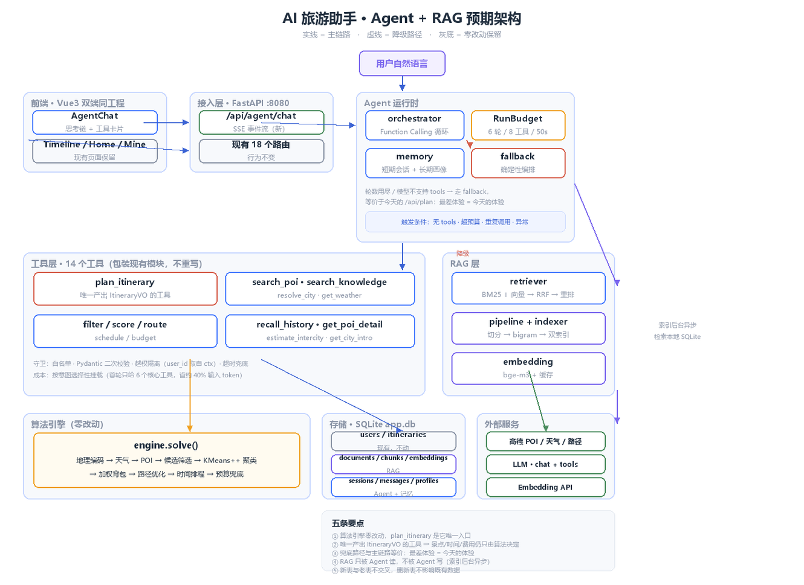
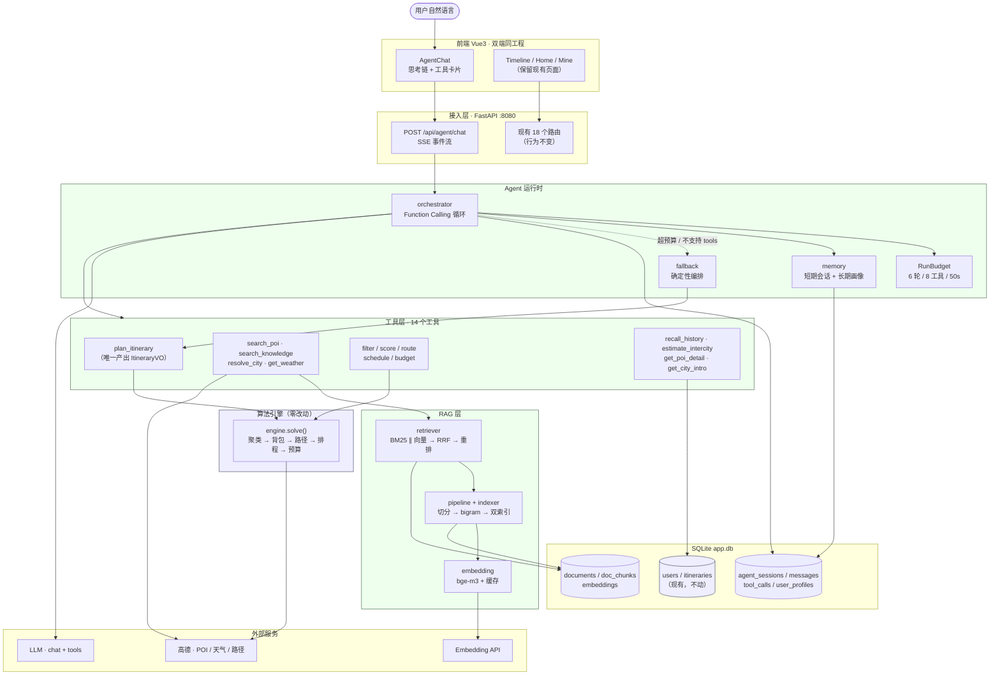

# AI 旅游助手 · Agent + RAG 预期架构图

> 对应 [重构设计文档](./AI旅游助手-Agent+RAG-重构设计文档.md) 的 §2 目标架构。
> 实线 = 主链路；虚线 = 降级路径。**算法引擎一行不改**，只是被包成了工具。



<details>
<summary>Mermaid 源码（可在支持 Mermaid 的编辑器中折叠/重绘）</summary>



</details>

## 五条要看出来的设计

| # | 设计 | 在图上哪里 |
| --- | --- | --- |
| 1 | **算法引擎零改动** | `ENGZ` 与现有 `D1` 是仅有的两个"不改"块；`plan_itinerary` 是它唯一的入口 |
| 2 | **唯一产出 `ItineraryVO` 的工具** | `T1`。Agent 不允许自己写行程——这是"景点/时间/费用只能由算法决定"红线的落地方式 |
| 3 | **兜底与主链路等价** | `ORC ⇢ FB` 虚线。预算耗尽 = 走今天的 `/api/plan`，**最差体验 = 今天的体验** |
| 4 | **RAG 只被 Agent 读、不被 Agent 写** | `T2 → RET` 是单向下行；索引由 `PIPE` 在后台异步做 |
| 5 | **新表与老表不交叉** | `D2`/`D3` 与 `D1` 无外键交叉（仅 `user_id` 指向 `users`），删新表不影响既有数据 |

## 与现状的差异（就这四处）

| | 现状 | 改造后 |
| --- | --- | --- |
| 入口 | 表单 → `/api/plan` | 自然语言 → `/api/agent/chat`（**表单保留**） |
| 决策 | 固定流水线 | Agent 自主决定调哪些工具（**决策权仍在算法引擎**） |
| 知识 | 无 | 混合检索（BM25 + 向量 + RRF + 重排） |
| 记忆 | 无 | 会话上下文 + 跨会话用户画像 |

## 阶段 7 增量（可选，图中未画）

```
新增：lookup_transit_schedule / check_booking_rule / check_closure_notice
      + web_cache 表 + <web> 标签隔离
约束：只进答复文本，绝不写回 ItineraryVO（W4）
```
